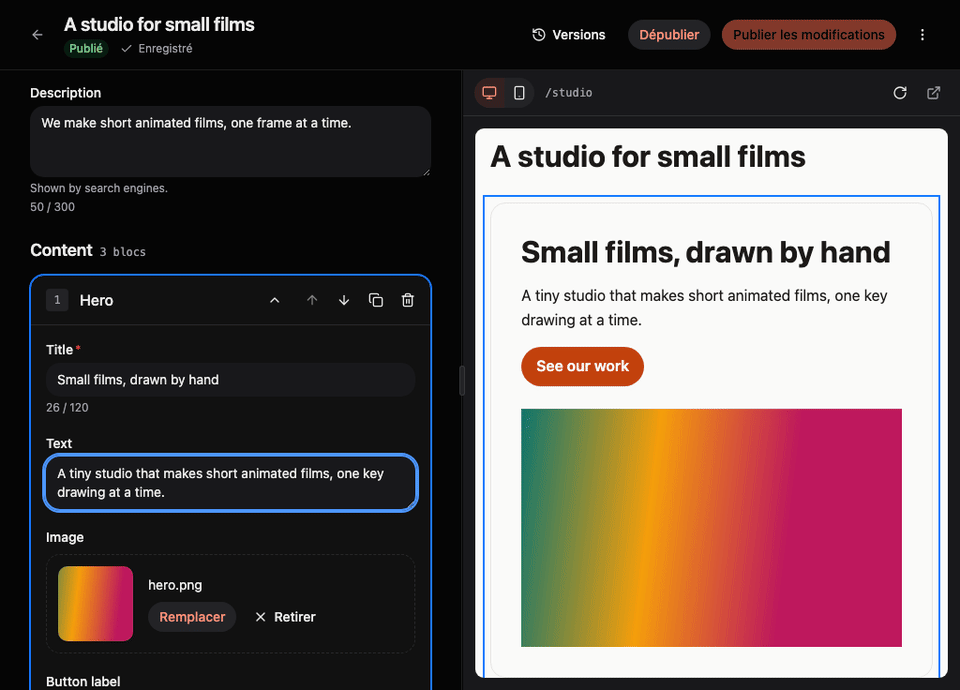
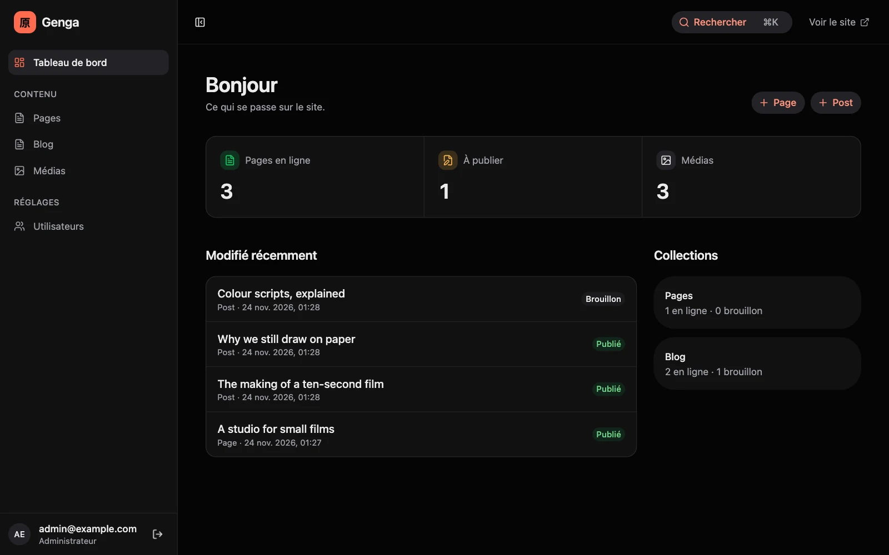
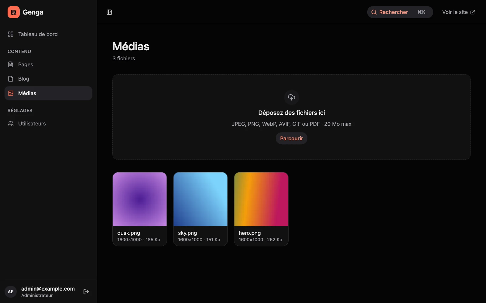
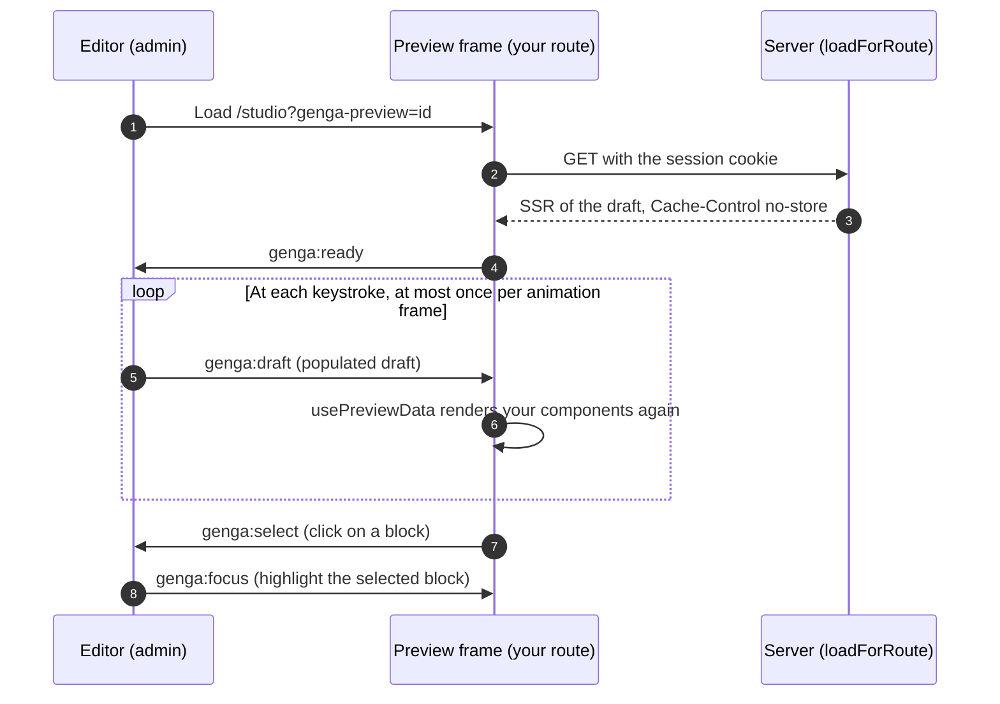
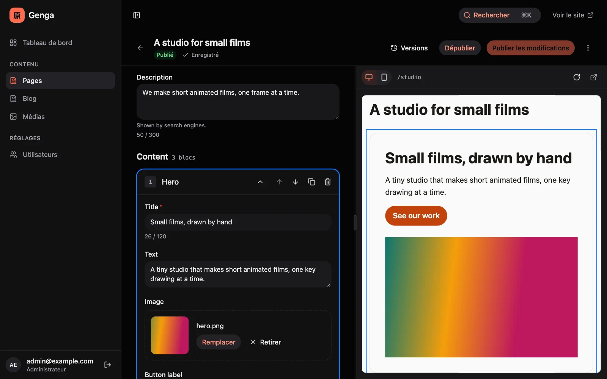
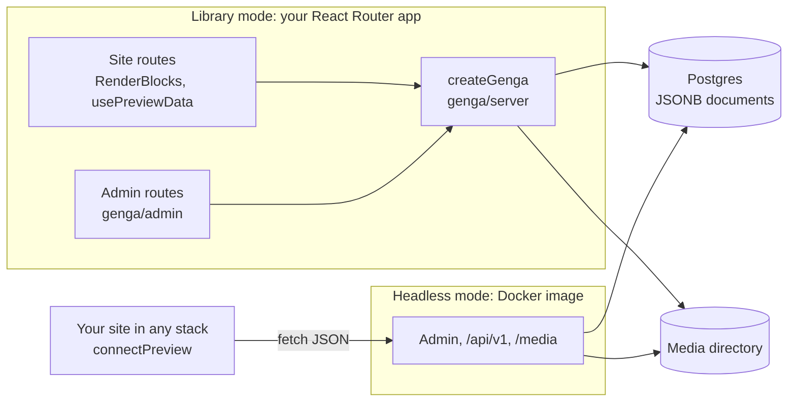

<p align="center">
  <picture>
    <source media="(prefers-color-scheme: dark)" srcset="./docs/assets/logo-dark.svg">
    
  </picture>
</p>

<h1 align="center">Genga 原画</h1>

<p align="center">
  <strong>A React CMS that lives inside your app, and edits your real components live.</strong>
</p>

<p align="center">
  <a href="https://www.npmjs.com/package/genga"></a>
  <a href="https://www.npmjs.com/package/genga"></a>
  <a href="https://github.com/sakuga-software/genga/actions/workflows/ci.yml"></a>
  <a href="./LICENSE"></a>
  <a href="https://github.com/sakuga-software/genga/pkgs/container/genga"></a>
  <a href="https://nodejs.org"></a>
  <a href="https://www.typescriptlang.org"></a>
</p>

_Genga_ (原画) are the key drawings of an animation: the frames that set the motion before
the in-betweens are drawn. Genga the CMS gives your site those key frames: an admin, roles,
drafts, versions, a media library, and a live editor that renders **your own React
components** as you type.

Use it in two ways:

- **As a library** inside a React Router app: `npm i genga`, mount a few routes, done. The
  site and the CMS share one server, one deploy and one Postgres database.
- **As a headless CMS** in Docker, with a public JSON API and a live preview bridge for a
  site in any stack (Next.js, Astro, Nuxt, SvelteKit, plain HTML).

<p align="center">
  
</p>

> **Status:** 0.1, early. The admin UI is in French for now.

## Contents

- [Why Genga](#why-genga)
- [Features](#features)
- [Quick start: inside a React Router app](#quick-start-inside-a-react-router-app)
- [Quick start: headless with Docker](#quick-start-headless-with-docker)
- [How live preview works](#how-live-preview-works)
- [Architecture at a glance](#architecture-at-a-glance)
- [Public API](#public-api)
- [MCP for AI agents](#mcp-for-ai-agents)
- [Security](#security)
- [Comparison](#comparison)
- [Roadmap](#roadmap)
- [Documentation](#documentation)
- [Contributing](#contributing)
- [License](#license)

## Why Genga

- **A CMS is often a second app.** It has its own server, its own deploy, its own database
  and its own auth. For a marketing site or a blog, that is a lot of moving parts.
- **Previews are often approximate.** The editor shows a form, and the site renders the
  content with other components. Authors publish to find out what the page looks like.
- **Blocks drift from the site.** The block schema lives in the CMS and the component lives
  in the site. They get out of sync.
- **Genga keeps it in one place.** A block is one React component of your site plus its
  field schema. The editor renders that component, on the real route, with the draft data.

## Features

**Editing**

- Pages are lists of blocks. A block is a React component of your site with a field schema.
- Live preview of the real route in a frame. It updates at each keystroke, without a reload.
  Desktop and mobile widths. A click on a block in the preview selects it in the form.
- Fields: `text`, `textarea`, `slug`, `number`, `boolean`, `select`, `date`, `url`, `tags`,
  `media`, `richText`, `array`, `blocks`, `group`.
- Rich text with TipTap, stored as JSON and rendered from an allowlist.

**Content workflow**

- One draft and at most one published version per document. Autosave with a
  compare-and-set on a draft revision: two editors never overwrite each other silently.
- Publish, unpublish, versions with notes, restore.
- Slug changes after a publish write a redirect. The old URL answers `301`.
- Roles `admin`, `editor` and `author`, with overrides per collection. An author edits only
  its own documents and cannot publish.

**Media**

- Upload with type sniffing (JPEG, PNG, WebP, AVIF, GIF, PDF; no SVG).
- WebP sizes (480, 960, 1600) with sharp, metadata removed.
- Content-hash keys: the same file uploaded twice is stored once.
- Alt text in the library, and a warning in the editor when it is missing.

**Rendering and data**

- SSR first. The site renders published content on the server. Drafts render only for
  signed-in users who can read the collection.
- Published reads go through an in-process cache with `ETag`, plus a sitemap helper.
- Postgres with JSONB documents. A new field needs no SQL migration. Migrations are
  expand-only and run under an advisory lock.

**Admin**

- Accessible: WCAG 2.2 AA, keyboard first, visible focus, labels and live regions.
- Built on open-source HeroUI v3, React Aria Components and TipTap. Command palette (⌘K).
- A compiled stylesheet: your app needs no Tailwind setup.

**Headless**

- Docker image `ghcr.io/sakuga-software/genga`: admin, public API and media in one container.
- Public read API v1 with `ETag`/`304`, CORS allow list and a rate limit. OpenAPI 3.1 file.
- Live preview for a site on another origin, with signed preview tokens.

| Dashboard                                                                                  | Media library                                                    |
| ------------------------------------------------------------------------------------------ | ---------------------------------------------------------------- |
|  |  |

## Quick start: inside a React Router app

Requirements: Node 22.12 or later (React Router 8 needs 22.22), React 19, React Router 7
or 8, Postgres 14 or later.

```sh
npm i genga
```

> Genga accepts React Router 7.18 and React Router 8.5 or later.

**1. Define a block and a collection.** A block is a component and its fields.

```tsx
// app/blocks/hero.tsx
import { defineBlock, text, textarea } from 'genga';

export const heroBlock = defineBlock({
  type: 'hero',
  label: 'Hero',
  fields: {
    title: text({ label: 'Title', required: true, maxLength: 120 }),
    text: textarea({ label: 'Text', rows: 2 }),
  },
  component: ({ title, text: body }) => (
    <section className="hero">
      <h2>{title}</h2>
      {body && <p>{body}</p>}
    </section>
  ),
});
```

```ts
// app/genga.config.ts
import { blocks, defineConfig, slug, text, type FieldValues } from 'genga';
import { heroBlock } from './blocks/hero';

const pageFields = {
  title: text({ label: 'Title', required: true }),
  slug: slug({ label: 'Slug', from: 'title', required: true }),
  body: blocks({ label: 'Content' }),
};
export type PageData = FieldValues<typeof pageFields>;

export const gengaConfig = defineConfig({
  collections: {
    pages: {
      label: 'Pages',
      labelSingular: 'Page',
      titleField: 'title',
      path: (value) => `/${value}`,
      fields: pageFields,
    },
  },
  blocks: [heroBlock],
});
```

**2. Create one instance per process.**

```ts
// app/.server/genga.ts
import { createGenga } from 'genga/server';
import { gengaConfig } from '../genga.config';

export const genga = createGenga(gengaConfig, {
  databaseUrl: process.env.DATABASE_URL!,
  siteUrl: process.env.SITE_URL ?? 'http://localhost:5173',
});
```

**3. Mount the admin, its API and the media route.** Each admin route module is a few
lines: a loader that calls `genga.admin.*` and a page component from `genga/admin`. The shell route links
`genga/admin.css`, and `root.tsx` sets `data-genga-admin` on `<html>` for the admin paths.

<details>
<summary>The route config and one admin route module</summary>

```ts
// app/routes.ts
import { type RouteConfig, index, layout, route } from '@react-router/dev/routes';

export default [
  route('/admin/api/*', 'routes/admin/api.ts'),
  route('/admin', 'routes/admin/shell.tsx', [
    route('login', 'routes/admin/login.tsx'),
    route('setup', 'routes/admin/setup.tsx'),
    layout('routes/admin/app.tsx', [
      index('routes/admin/dashboard.tsx'),
      route('collections/:collection', 'routes/admin/collection.tsx'),
      route('collections/:collection/:id', 'routes/admin/document.tsx'),
      route('media', 'routes/admin/media.tsx'),
      route('users', 'routes/admin/users.tsx'),
    ]),
  ]),
  route('/media/*', 'routes/media.ts'),
  route('/:slug', 'routes/page.tsx'),
] satisfies RouteConfig;
```

```tsx
// app/routes/admin/document.tsx
import { DocumentPage } from 'genga/admin';
import { genga } from '../../.server/genga';
import type { Route } from './+types/document';

export async function loader({ request, params }: Route.LoaderArgs) {
  await genga.ready();
  return genga.admin.document(request, params.id);
}

export default DocumentPage;
```

</details>

**4. Render a page, with live preview.**

```tsx
// app/routes/page.tsx
import { RenderBlocks, usePreviewData } from 'genga/client';
import { data, redirect } from 'react-router';
import { genga } from '../.server/genga';
import { gengaConfig, type PageData } from '../genga.config';
import type { Route } from './+types/page';

export async function loader({ request, params }: Route.LoaderArgs) {
  await genga.ready();
  const result = await genga.published.loadForRoute<PageData>(request, 'pages', params.slug);
  if (result.kind === 'redirect') throw redirect(result.location, { status: 301, headers: result.headers });
  if (result.kind === 'not-found') throw data(null, { status: 404, headers: result.headers });
  return data({ doc: result.doc, preview: result.preview }, { headers: result.headers });
}

export default function Page({ loaderData }: Route.ComponentProps) {
  const { data: page } = usePreviewData(loaderData.doc, loaderData.preview);
  return (
    <article>
      <h1>{page.title}</h1>
      <RenderBlocks blocks={page.body} registry={gengaConfig.blocks} preview={loaderData.preview} />
    </article>
  );
}
```

Start the app with `DATABASE_URL` set. At the first start, the server logs a one-time link
`/admin/setup?token=…` that creates the first admin.

The [example app](./examples/react-router) has every route module, the admin stylesheet link,
the cache headers and a blog collection. Copy from it. Read
[configuration](./docs/configuration.md) and [blocks](./docs/blocks.md) for the details.

## Quick start: headless with Docker

```sh
curl -O https://raw.githubusercontent.com/sakuga-software/genga/main/apps/server/docker-compose.example.yml
curl -O https://raw.githubusercontent.com/sakuga-software/genga/main/apps/server/config.example.json
export GENGA_SECRET="$(openssl rand -base64 48)"
docker compose -f docker-compose.example.yml up
```

1. Open the one-time setup link that the server logs, and create the first admin.
2. Write and publish a post at <http://localhost:3000/admin>.
3. Read it: `curl http://localhost:3000/api/v1/collections/posts/documents`.

The collections and blocks come from `config.example.json` (a JSON or `.mjs` file). The
blocks are schemas only: your site renders them. Read [headless server](./docs/headless-server.md)
for the settings, the reverse proxy and the backups.

## How live preview works

The editor loads the real site route in a frame, with `?genga-preview=<id>`. The route renders
the draft on the server. After that, the editor sends each change with `postMessage`, and
the page renders again without a reload.



- **Same origin** (library mode): the frame reads the draft with the session cookie.
- **Another origin** (headless mode): the preview URL carries an HMAC token, valid 10 minutes
  for one document. `connectPreview` from `genga/preview` (about 6 KB, no dependency) works
  in any framework.

Both sides post only to the exact origin of the other side, and check `event.origin` and
`event.source`. Read [preview bridge](./docs/preview-bridge.md).

<p align="center">
  
</p>

## Architecture at a glance



| Entry           | Content                                                                       |
| --------------- | ----------------------------------------------------------------------------- |
| `genga`         | `defineConfig`, `defineBlock`, field builders, access rules, `richTextToHtml` |
| `genga/server`  | `createGenga`: auth, documents, published reads, media, admin loaders, API    |
| `genga/admin`   | the admin route components                                                    |
| `genga/client`  | `RenderBlocks`, `RichText`, `usePreviewData`, the preview bridge              |
| `genga/preview` | `connectPreview` for any framework, no React                                  |

The headless server in [`apps/server`](./apps/server) is a small React Router app that
imports `genga` like any other app. Read [architecture](./docs/architecture.md) for the data
model, the cache and the operations.

## Public API

The headless server serves published content under `/api/v1`: `GET`, `HEAD` and `OPTIONS`
only, no authentication, CORS from an allow list, a rate limit per client address.

```sh
curl http://localhost:3000/api/v1/collections/posts/documents/paper
```

<details>
<summary>The answer</summary>

```jsonc
{
  "document": {
    "id": "3f54cee2-6be8-4eff-ae55-ed701fb9bb13",
    "collection": "posts",
    "slug": "paper",
    "path": "/blog/paper",
    "publishedAt": "2026-11-24T00:28:36.841Z",
    "data": {
      "title": "Why we still draw on paper",
      "excerpt": "Paper is fast, cheap and forgiving. A few notes on our tools.",
      "cover": {
        "url": "http://localhost:3000/media/050e26e5…474a.png",
        "alt": "A purple gradient",
        "width": 1600,
        "height": 1000,
        // also: id, filename, mime, and the WebP sizes
      },
      "publishedDate": "2026-10-28",
      "tags": ["process"],
      "body": [],
    },
    // also: versionId
  },
}
```

</details>

Responses carry an `ETag`: send it back in `If-None-Match` to get a `304`. Rich text comes
with its `html`, and media URLs are absolute. Read [public API](./docs/api.md) and the
[OpenAPI 3.1 file](./docs/openapi.yaml).

## MCP for AI agents

Genga ships an [MCP](https://modelcontextprotocol.io) server: an AI
agent reads and writes content through tools, with a personal API token. The token has the
role of its user, so an agent can do what that user can do, and no more. Read
[MCP](./docs/mcp.md).

## Security

Genga went through two adversarial security reviews. In short:

- Sessions: scrypt passwords, opaque tokens stored as sha256, `__Host-` cookie, login limits.
- CSRF: every write must come from an allowed origin.
- Content: zod validation at write time, sanitized rich text, a URL rule that refuses
  `javascript:` and its variants.
- Media: sniffed types, no SVG, sandboxed responses, keys served only through their database row.
- Preview: drafts only for signed-in readers, or with a signed token for one document.

Read the [security model](./docs/security.md). Report a vulnerability as described in
[SECURITY.md](./SECURITY.md).

## Comparison

Genga is small and young. The projects below are mature and do much more. This table is a
fair summary of the points where the choice differs.

|                            | Genga                                      | Payload                   | Strapi                                                               | Sanity                                             | Directus                                               |
| -------------------------- | ------------------------------------------ | ------------------------- | -------------------------------------------------------------------- | -------------------------------------------------- | ------------------------------------------------------ |
| Runs inside your app       | Yes, a React Router 7 or 8 app             | Yes, a Next.js app        | No, a separate server                                                | No, the content is in Sanity's hosted Content Lake | No, a separate server                                  |
| Headless API               | REST, read-only, OpenAPI                   | REST, GraphQL, Local API  | REST, GraphQL (plugin)                                               | GROQ, GraphQL                                      | REST, GraphQL                                          |
| Live preview in the editor | Your components, updated at each keystroke | Yes, updated as you type  | Preview in the admin; side by side on paid plans, updated after save | Presentation tool, with click to edit              | Preview pane, refreshed after save; Visual Editor      |
| Self-hosted                | Yes                                        | Yes                       | Yes, or Strapi Cloud                                                 | The Studio; the content is hosted                  | Yes                                                    |
| Database                   | Postgres (JSONB)                           | MongoDB, Postgres, SQLite | PostgreSQL, MySQL, MariaDB, SQLite                                   | Content Lake (hosted)                              | PostgreSQL, MySQL, SQLite, MS SQL, Oracle, CockroachDB |
| License                    | MIT                                        | MIT                       | MIT (Community Edition); `ee/` under its own license                 | Studio: MIT                                        | Monospace Sustainable Core License (source-available)  |

This comparison reflects our understanding of each project's documentation in November 2026.
If a cell is wrong or out of date, please [open an issue](https://github.com/sakuga-software/genga/issues)
and we will correct it.

## Roadmap

These items are **planned**, not available yet:

- Adapters for other JavaScript frameworks: Next.js, Astro, Nuxt and SvelteKit (React Router
  is supported now).
- A documentation site.
- S3-compatible media storage (the storage interface exists).
- Localization of the content (i18n).
- Scheduled publishing.

## Documentation

- [Architecture](./docs/architecture.md)
- [Configuration](./docs/configuration.md)
- [Blocks](./docs/blocks.md)
- [Preview bridge](./docs/preview-bridge.md)
- [Headless server](./docs/headless-server.md)
- [Public API](./docs/api.md) and its [OpenAPI file](./docs/openapi.yaml)
- [Security model](./docs/security.md)
- [Changelog](./CHANGELOG.md)

## Contributing

Issues and pull requests are welcome. Open an issue before a large change, so that we can
agree on the approach first. [CONTRIBUTING.md](./CONTRIBUTING.md) explains the setup and the
checks: lint, format, typecheck, and more than 95 tests that run on a real Postgres.

## License

[MIT](./LICENSE) © Sakuga Software

<p align="center">
  Made by <a href="https://sakuga.dev">Sakuga Software</a> (作画) in Bordeaux.
</p>
