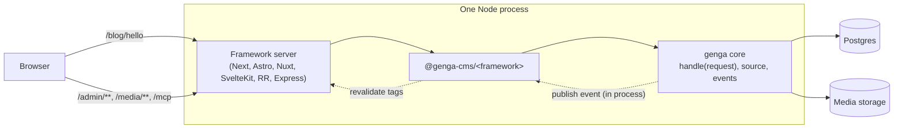
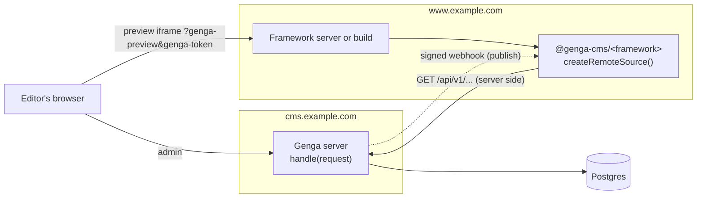

# Framework adapters (specification)

Status: proposal for review. Ticket: [GNG-1](https://linear.app/sakuga-software/issue/GNG-1). Follow-up tickets:
GNG-4 (Next.js), GNG-5 (Astro), GNG-6 (Nuxt), GNG-7 (SvelteKit), GNG-3 (sakuga.dev). This document describes a
design. It does not describe code that exists today.

Today Genga runs in two ways:

- **Inside a React Router app.** The app mounts the admin route modules of `genga/admin` and calls `createGenga()`
  in its loaders.
- **As the headless server.** The Docker image `ghcr.io/sakuga-software/genga` serves the admin and the public API.
  Any site reads it over HTTP.

The goal is to integrate Genga with the major JavaScript frameworks: Next.js, Astro, Nuxt, SvelteKit, React Router,
and plain Node (Express, Hono). Each adapter supports two modes, **embedded** and **remote**, and the same block
schema.

A companion document, [On-site editing](./on-site-editing.md), designs the editing of content directly on the site
page. It builds on the preview protocol of this document.

## 1. Decisions

| #   | Decision                                                                                                                                                                                                  | Section |
| --- | --------------------------------------------------------------------------------------------------------------------------------------------------------------------------------------------------------- | ------- |
| D1  | The server core becomes **fetch-first**. One handler, `genga.handle(request)`, answers every Genga path: admin, admin API, media, public API, MCP, webhooks. It returns `null` for other paths.           | 3.1     |
| D2  | The admin becomes a **prebuilt single-page app** (SPA). The core serves its HTML shell and its assets. The admin needs no React, no React Router and no Tailwind in the site.                             | 3.2     |
| D3  | `genga/server` loses its import of `react-router`. The `react-router` peer dependency leaves `genga` at 1.0.                                                                                              | 3.2, 11 |
| D4  | A **content source** interface reads content in both modes: `createGenga()` for embedded, `createRemoteSource()` for remote. Adapters depend only on this interface.                                      | 3.3     |
| D5  | The source returns the **public document shape** in both modes: absolute media URLs and rich text with `html`. A block component works in both modes without a change.                                    | 3.3     |
| D6  | Preview credential: the **admin session** on the same origin (as today), a **signed token** on another origin. A token never reaches a cache or a `Referer`, and the editor renews it.                    | 3.4     |
| D7  | The core emits **publish events** in process and as **signed webhooks**. Each event carries **cache tags**. Adapters map the tags to the cache of their framework.                                        | 3.5     |
| D8  | The config holds **schemas only**. Each adapter has a **block registry** that maps a block type to a component of its framework.                                                                          | 5       |
| D9  | Packages: `genga` (core) plus `@genga-cms/react`, `@genga-cms/next`, `@genga-cms/astro`, `@genga-cms/nuxt`, `@genga-cms/sveltekit`, `@genga-cms/react-router`, `@genga-cms/node`.                         | 4       |
| D10 | Embedded mode needs **one long-running Node process**. Serverless, edge and multi-replica deployments use remote mode.                                                                                    | 2, 7.6  |
| D11 | All packages share **one version** and one release tag, in lockstep, while Genga is `0.x`.                                                                                                                | 10      |
| D12 | Two steps. **Step 1**: Fetch handler, public API, events, remote source, then Next.js in remote mode against the current admin. **Step 2**: the SPA admin and embedded mode. Then Astro, Nuxt, SvelteKit. | 12      |

## 2. The two modes

### Embedded

Genga runs inside the server of the site. One origin serves the site, the admin, the APIs and the media. The site
reads published content in process, without HTTP.



Use embedded mode when:

- the site runs as one long-running Node server (a container, a VM, a Node host),
- one team owns the site and its content model,
- you want one deployment and same-origin preview.

### Remote

The site talks to a Genga server over the [public API](./api.md). The Genga server is the Docker image, or another
app that mounts `genga.handle`. The admin is on the Genga origin.



Use remote mode when:

- the site runs on serverless or edge platforms, or on more than one replica,
- the site is static (SSG) and rebuilds on publish,
- several sites share one content server,
- the site cannot run Postgres and `sharp` (for example Cloudflare Workers).

### How a site chooses

The adapter receives a source, and the source decides the mode: `createGenga(config, { databaseUrl, … })` for
embedded mode (the site owns the database), or `createRemoteSource({ url: process.env.GENGA_URL, schema: config })`
for remote mode. There is no global mode switch. A site that wants both (for example remote in production and
embedded in local development) chooses in its own code. The examples read `GENGA_URL`: if it is set, they use remote
mode.

## 3. The core boundary

### What stays in `genga` and what each adapter adds

| Concern                    | `genga` (framework-agnostic)                                     | Adapter                                                         |
| -------------------------- | ---------------------------------------------------------------- | --------------------------------------------------------------- |
| HTTP surface               | `genga.handle(request, context?)`: one Fetch handler             | Mounts it on framework routes; passes the client address        |
| Admin UI                   | Prebuilt SPA: HTML shell, assets, admin API                      | Nothing: the handler serves it                                  |
| Content reads              | `GengaSource`: `getDocument`, `listDocuments`, `resolveRoute`, … | Wraps them for the data loading of the framework, adds caching  |
| Preview                    | Session and token checks, `connectPreview`, bridge messages      | Detects preview mode, injects the bridge client, refresh method |
| Rendering                  | `richTextToHtml`, `toPublicData`, block annotations              | Block registry and components for its component model           |
| Cache invalidation         | Events, tags, signed webhooks                                    | Maps tags to `revalidateTag`, `Astro.cache`, Nitro storage, …   |
| Database, auth, media, MCP | All of it                                                        | Nothing                                                         |

### 3.1 One Fetch handler

```ts
type HandleContext = {
  /** The TCP peer, when the framework gives it. The core appends it to X-Forwarded-For as one more hop. */
  peerAddress?: string;
};

interface Genga extends GengaSource {
  /** A Response for a Genga path, or null for any other path. */
  handle(request: Request, context?: HandleContext): Promise<Response | null>;
  events: GengaEvents; // section 3.5
  ready(): Promise<void>;
  close(): Promise<void>;
}
```

The handler routes on the path:

| Path                 | Content                                                         | Default in embedded | Default in the server image |
| -------------------- | --------------------------------------------------------------- | ------------------- | --------------------------- |
| `<adminPath>`, `/**` | Admin HTML shell (any sub-path) and `<adminPath>/_app/*` assets | on                  | on                          |
| `<adminPath>/api/**` | Admin JSON API (session cookie)                                 | on                  | on                          |
| `<mediaPath>/**`     | Media files                                                     | on                  | on                          |
| `/api/v1/**`         | Public read API and the preview endpoint                        | off                 | on                          |
| `<mcpPath>`          | MCP endpoint (Streamable HTTP)                                  | off                 | on                          |

Options: `adminPath` (default `/admin`), `mediaPath` (default `/media`), `publicApi` (`false | true`), `mcp`
(`false | { path, allowedOrigins }`). The media path becomes configurable, because `mediaUrl()` hardcodes `/media/`
today and a site can own that path.

Refactors in the core:

- **R1.** Move the public API, the preview endpoint and the token bucket from
  `apps/server/app/.server/public-api.ts` into `genga/server`. The server image then mounts `genga.handle` like any
  other app.
- **R2.** Replace the React Router `data()` and `redirect()` in `server/admin.ts` with `GengaError` and plain JSON.
  Reuse the JSON routes of `server/api.ts` where they exist (documents, media, users, tokens). Add a JSON route only
  for the page data that has none today: the layout, the dashboard, and the schema of the document page.

  **Change (GNG-27).** Each screen has one route, `GET <adminPath>/api/views/<screen>`, with the `*PageData` shape
  of its old loader. The pages need fields that the resource routes do not give (`canDelete`, `currentUserId`,
  `allTokens`, the status filter of a collection), and one route per screen keeps the old loaders and the admin app
  on the same code. The writes still use the resource routes.

- **R3.** Add the unauthenticated endpoints that the login and setup forms use today through React Router actions:
  `POST <adminPath>/api/session` (login), `GET <adminPath>/api/setup` (describe a token),
  `POST <adminPath>/api/setup` (accept it). They keep the origin check, the login limits and the body limits.
- **R4.** Add `handle()` as the single router. Keep `genga.api`, `genga.mcp` and `genga.media.serve` as deprecated
  aliases during `0.x`.
- **R5.** Add `peerAddress` to the request context. The core appends it to `X-Forwarded-For`, as
  `apps/server/server.mjs` does today, and counts it as one more hop. The client address then always comes from
  `trustedProxies`. A framework address never overrides the header: behind a proxy it is the address of the proxy,
  and all editors would share one login bucket.
- **R6.** Make `mediaPath` an option; `mediaUrl()` and `toPublicMedia()` read it.

### 3.2 The admin as a prebuilt SPA

**Decision.** `genga` ships the admin as a static bundle built with Vite: React, React Router (data mode, bundled,
not a peer), HeroUI, TipTap and the compiled CSS. The handler serves:

- `<adminPath>/_app/<file>`: the hashed assets, with `Cache-Control: public, max-age=31536000, immutable` and
  `X-Content-Type-Options: nosniff`.
- any other path under `<adminPath>`: the HTML shell, with the admin headers.

The page components keep their markup and their hooks: `useLoaderData`, `Form`, `useActionData`, `useRevalidator`
and `useBlocker` still work, because the SPA uses React Router in data mode internally. The data layer is new: each
loader becomes a client loader that calls the JSON routes of R2, each `Form` action calls R3, and a 401 sends the
router to the login page. This is real work, so it is step 2 of the plan (section 12).

**The HTML shell.** The core renders it at each request, with no inline script:
`<html class="dark" data-theme="dark" data-genga-admin>`, a `robots` meta tag, a `genga-admin-path` meta tag with
the admin path, one stylesheet and one module script under `<adminPath>/_app/`, and an empty root element.

- **Base path.** The bundle builds with a relative base, so its dynamic imports resolve from the URL of the entry
  script. The router reads its basename from the `genga-admin-path` meta tag. `adminPath` therefore stays a runtime
  option.
- **SSR and hydration.** None. The admin is behind a login and `noindex`. The shell shows a loading state until the
  first JSON view arrives. This removes every hydration concern from the adapters, and the admin no longer depends
  on the React version of the site.
- **Auth cookie.** Unchanged: `__Host-genga` with `Secure`, `HttpOnly`, `SameSite=Lax`, `Path=/`, no `Domain`.
  `__Host-` requires `Path=/`, so the cookie works under any `adminPath`. A site that runs its own auth must not use
  the cookie name `genga`.
- **CSP of the admin.** The handler sets it on the shell, independent of the site:
  `default-src 'self'; script-src 'self'; style-src 'self'; style-src-attr 'unsafe-inline'; img-src 'self' data: blob: <media origin>; connect-src 'self'; frame-src 'self' <preview origins>; frame-ancestors 'self'; base-uri 'none'; form-action 'self'; object-src 'none'`.
  `style-src-attr` is necessary because React Aria sets `style` attributes. The prototype must confirm that HeroUI
  and TipTap need nothing more.
- **Site CSP.** The site must not add its own CSP to admin responses. Each adapter mounts the handler before the CSP
  layer of the framework, or excludes `<adminPath>` from it (section 7).
- **Other headers.** `X-Robots-Tag: noindex, nofollow`, `Cache-Control: private, no-store` on the shell and the API,
  as today.

**Alternatives considered.**

| Option                                                            | Why not                                                                                               |
| ----------------------------------------------------------------- | ----------------------------------------------------------------------------------------------------- |
| Keep React Router route modules and add one variant per framework | Five copies of the routing. Vue, Svelte and Astro sites would need React SSR.                         |
| Server-render the admin in the core with `renderToString`         | Hydration bugs, React as a hard dependency of every site, and little value for a page behind a login. |
| Serve the admin only from the headless server, in an iframe       | Two deployments for embedded users, cross-origin cookies, and no same-origin preview.                 |
| An Astro island or a Next client page that hosts the admin        | One host per framework, each with its own bundling of React and its own risks.                        |

**Out of scope.** Theming the admin from the site, admin plugins, and an admin path with more than one segment.

### 3.3 The content source

Both modes implement one interface. Adapters and site code use it, never the database.

```ts
type PublicDocument<T> = {
  id: string;
  collection: string;
  slug: string;
  path: string;
  versionId: string | null; // null in a preview
  publishedAt: string | null;
  data: T; // media URLs absolute, rich text with `html`
};

type CacheInfo = { tags: string[]; etag?: string } | 'no-store';

type RouteResult<T> =
  | { kind: 'document'; doc: PublicDocument<T>; preview: boolean; cache: CacheInfo; headers: Headers }
  | { kind: 'redirect'; location: string; status: 301; cache: CacheInfo; headers: Headers }
  | { kind: 'not-found'; cache: CacheInfo; headers: Headers };

interface GengaSource {
  readonly mode: 'embedded' | 'remote';
  getDocument<T>(collection: string, slug: string): Promise<PublicDocument<T> | null>;
  listDocuments<T>(collection: string, query?: ListQuery): Promise<DocumentPage<T>>;
  /** Published document, redirect, not found, or the draft for a valid preview (section 3.4). */
  resolveRoute<T>(request: Request | PreviewInput, collection: string, slug: string): Promise<RouteResult<T>>;
  getDraft<T>(documentId: string, token: string): Promise<PublicDocument<T> | null>;
  sitemap(): Promise<{ path: string; lastModified: string | null }[]>;
  tagsFor(collection: string, slug?: string): string[];
}
```

- **Embedded** (`createGenga`): reads from the in-process cache and Postgres, then applies `toPublicData` with the
  site origin. Today `published.find` returns relative media URLs and rich text without `html`. The new methods use
  the public shape. The old methods stay during `0.x`.
- **Remote** (`createRemoteSource({ url, schema?, fetch? })`, entry `genga/remote`): calls `/api/v1`. It runs
  anywhere `fetch` and WebCrypto exist, edge runtimes included. The `fetch` option lets an adapter add framework
  cache hints (Next `next.tags`, for example). `schema` (the config) gives TypeScript types; without it the data is
  `unknown`.
- `ListQuery` matches the public API: `limit`, `cursor`, `tag`, `sort`. The embedded source implements the same
  paging.
- `PreviewInput` is `{ documentId, token?, cookie? }` for frameworks that give no `Request` to a page (Next Server
  Components): the token in remote mode, the `Cookie` header (admin session) in embedded mode. The adapter builds it
  from its own preview cookie and `cookies()`.
- **One tag set.** `RouteResult.cache.tags` is `tagsFor(collection, slug)`. A redirect result also carries the tag
  of the old slug.
- **Conformance.** One test suite runs against both sources: same results, same tags, same errors, for published,
  redirected, missing and previewed documents.

### 3.4 Preview

**Credentials.** The editor loads the `previewUrl` of the collection with `?genga-preview=<id>`. `resolveRoute`
returns the draft only if the document belongs to the collection and the slug of the route, and:

- **same origin** (embedded): the request has an admin session that can read the document, as today. No secret is in
  the URL.
- **another origin** (remote): the URL also holds `genga-token`, valid for this document. The site checks it with
  `GET /api/v1/preview/:id`. Only the Genga server holds `GENGA_SECRET`: a site that held it could mint tokens for
  every draft.

**Token hygiene.**

- Preview responses send `Cache-Control: private, no-store`, `Vary: Cookie`, `Referrer-Policy: no-referrer` and
  `X-Robots-Tag: noindex`. Adapters must forward these headers where the framework allows it. Next pages cannot set
  headers: Draft Mode makes them `no-store`, and the adapter sets `Referrer-Policy` in its preview entry route.
- The bridge client removes `genga-token` from the address bar with `history.replaceState`, and keeps it in memory.
- Tokens last 10 minutes; an editing session lasts longer. The editor sends a fresh token before expiry with a new
  message, `genga:token`. The refresh level (below) uses the token in memory.
- Adapters turn analytics and third-party tags off on preview responses.

**Live updates.** The bridge messages of [preview-bridge](./preview-bridge.md#messages) stay. Two messages are
added:

| Message       | From   | Purpose                                                                    |
| ------------- | ------ | -------------------------------------------------------------------------- |
| `genga:saved` | editor | The autosave stored the draft (`draftRev`). Server-rendered pages refresh. |
| `genga:token` | editor | A fresh preview token, before the current one expires (remote mode).       |

[On-site editing](./on-site-editing.md#8-messages) keeps the one table of all bridge messages.

There are two levels, and each adapter states which ones it supports:

- **Live**: blocks that render on the client apply each `genga:draft` at once (React `usePreviewData`, a Vue
  composable, a Svelte state). Latency: one animation frame.
- **Refresh**: blocks that render only on the server (React Server Components, `.astro` components) re-render with
  the framework refresh after each `genga:saved`. Latency: the autosave delay (1.5 s today) plus one server round
  trip.

**Alternative rejected.** The frame could POST the unsaved draft to the page and render it on the server. This
reflects request content into HTML, needs its own CSRF and token rules, and duplicates the autosave. The refresh
level reuses the draft that the autosave already stored.

**Same-site rule for remote mode.** A framework preview mode that uses a cookie (Next Draft Mode) needs that cookie
inside the editor iframe. If the admin and the site are on different sites (registrable domains), browsers can block
it. Put the CMS on a subdomain of the site (`cms.example.com` for `www.example.com`). Section 14 lists the fallback.

### 3.5 Publish events and cache tags

The core has no event today, only `cache.invalidate(collection)`. The new contract:

```ts
type GengaEvent = {
  id: string; // UUID, stable across webhook retries
  type:
    | 'document.published'
    | 'document.unpublished'
    | 'document.deleted'
    | 'document.slug_changed' // with document.published, when a publish changes the slug
    | 'media.updated' // alt text or file change
    | 'media.deleted';
  at: string; // ISO time
  collection: string | null; // null for media events
  documentId: string | null;
  slug: string | null;
  path: string | null; // the `path` of the collection, on the site
  previous: { slug: string; path: string } | null; // for slug changes
  versionId: string | null;
  tags: string[]; // the cache tags to invalidate
};
```

**Tags.** The core computes them. Adapters do not invent their own.

| Tag                           | Means                                      | Invalidated by                             |
| ----------------------------- | ------------------------------------------ | ------------------------------------------ |
| `genga`                       | Everything                                 | `media.updated`, `media.deleted`           |
| `genga:c:<collection>`        | Lists of a collection, its sitemap entries | every document event of the collection     |
| `genga:d:<collection>:<slug>` | One document by slug                       | events of that document (old and new slug) |

`tagsFor(collection, slug?)` gives the same tags to the read side, so a cached read and its invalidation always
agree. Media events use the broad tag because a media item can appear in any document; they are rare.

**In-process delivery.** `genga.events.on(type | '*', listener)`. Listeners run after the transaction commits, in
the request that published. An error in a listener is logged and does not fail the publish.

**Webhooks.** `createGenga(config, { webhooks: [{ url, secret, events? }] })`, and `GENGA_WEBHOOKS` on the server
image (a JSON array of the same objects).

- Body: the event as JSON. Headers follow the [Standard Webhooks](https://www.standardwebhooks.com/) layout:
  `webhook-id`, `webhook-timestamp`, `webhook-signature: v1,<base64 HMAC-SHA256 of id.timestamp.body>`.
- **Outbox.** The publish transaction also writes the event to a `genga_events` table (expand-only migration). A
  sender delivers from that table, with retries and backoff for 24 hours, so a restart loses nothing. Delivery is at
  least once: receivers are idempotent on `webhook-id`.
- **Reconciliation.** `GET /api/v1/events?after=<id>` lists recent events (7 days). An adapter calls it at start and
  every 5 minutes, so a missed webhook (site down, network) still invalidates its cache.
- **Safety TTL.** Adapter caches default to a `maxAge` of one hour, never "forever".
- Receivers (one per adapter) reject a timestamp older than 5 minutes. The secret is not `GENGA_SECRET`.

## 4. Packages and names

| Package                   | Content                                                                        | Peer dependencies                    |
| ------------------------- | ------------------------------------------------------------------------------ | ------------------------------------ |
| `genga`                   | Core: config, fields, server, handler, admin SPA, remote source, preview, HTML | none (React leaves at 1.0)           |
| `@genga-cms/react`        | `RenderBlocks`, `RichText`, `usePreviewData`, `defineBlockComponents`          | `react`, `genga`                     |
| `@genga-cms/next`         | Route handlers, Draft Mode, tag revalidation, `withGenga` config               | `next`, `react`, `genga`             |
| `@genga-cms/astro`        | Integration, injected routes, `<Blocks>`, live loader, route cache tags        | `astro`, `genga`                     |
| `@genga-cms/nuxt`         | Nuxt module, server handler, Vue components and composables                    | `nuxt`, `vue`, `genga`               |
| `@genga-cms/sveltekit`    | `handle` hook, Svelte components, preview state                                | `@sveltejs/kit`, `svelte`, `genga`   |
| `@genga-cms/react-router` | Resource route exports, loader helpers                                         | `react-router`, `react`, `genga`     |
| `@genga-cms/node`         | `toNodeListener`, Express and Hono helpers, webhook receiver                   | `genga` (optional `express`, `hono`) |

Entries of `genga` after the refactor: `genga` (config, fields, types, `richTextToHtml`), `genga/server`
(`createGenga`), `genga/remote` (`createRemoteSource`), `genga/preview` (`connectPreview`, no dependency),
`genga/edit` (reserved for on-site editing). `genga/admin`, `genga/render` and `genga/client` stay during `0.x` and
leave at 1.0 (section 11).

**npm scope.** `@genga` is taken: the scope belongs to an npm account named `genga` that is not ours
(`npm org ls genga` lists only that account). The decided scope is `@genga-cms`, an npm organization of the owner
(`npm org ls genga-cms`). The core keeps the unscoped name `genga`.

**Why separate packages, not `genga/next` subpaths.** Each framework needs its own peer range. Subpaths in one
package would make every framework an optional peer of `genga`, install type checks for frameworks that the site
does not use, and tie every framework bug fix to a core release.

## 5. Blocks across frameworks

**One schema.** The config defines block types with `defineBlock({ type, label, fields })`. The `component` property
of `defineBlock` is deprecated: the config stays free of framework code, so the admin, the server image and every
adapter load the same file.

**One registry per adapter.** Each adapter maps block types to components, with types from the config:

```ts
// React (Next, React Router, Astro React islands)
export const blocks = defineBlockComponents(config, { hero: Hero, quote: Quote });
// Vue (Nuxt)
export const blocks = defineBlockComponents(config, { hero: Hero, quote: Quote });
// Svelte, Astro: the same function, from their adapter.
```

`defineBlockComponents` checks at the type level that each key is a block type, and that the props of each component
accept `FieldValues` of that block plus `_id` and `_type`. A missing component renders nothing on the public site,
and a notice in preview, as `RenderBlocks` does today.

**The rendering contract.** Every `<Blocks>` component, in every framework:

- renders blocks in order, with the block `_id` as the key,
- wraps each block in an element with `data-genga-block-type`, and in preview also `data-genga-block` (index) and
  `data-genga-block-id`,
- isolates errors per block where the framework allows it (React error boundary, Vue `onErrorCaptured`, Svelte
  `<svelte:boundary>`, Astro: a `try` around each render),
- renders rich text with the `html` of the public shape (`set:html`, `v-html`, `{@html}`), or with
  `@genga-cms/react` `RichText` in React. The HTML comes from the allowlist renderer of the core. A site must not
  render the TipTap JSON with another renderer without the same sanitizer.

**Preview in the admin.** The admin always shows the real site page in an iframe. The block components therefore run
in their own framework, and the admin never loads them. The adapter gives the page the bridge client:
`usePreviewData` (React), `useGengaPreview` (Vue), `gengaPreview` (Svelte), and a small script for Astro.

## 6. Config

- **Location.** `genga.config.ts` at the root of the site (or under `src/` / `app/`, as the framework prefers). It
  imports only `genga`. The server code of the adapter and the site code import it.
- **Remote mode.** The server image reads JSON or `.mjs` and cannot import TypeScript. A new command,
  `genga config export genga.config.ts > genga.config.json`, writes the schema-only JSON for the server. The site
  keeps the `.ts` file as the source of truth, for types and for `createRemoteSource({ schema })`. A function
  `previewUrl` or `path` cannot go to JSON: the export fails with a message that names it.
- **Mismatch check.** At start, `createRemoteSource` can compare its schema with `GET /api/v1/collections` and warn
  when the two differ (`checkSchema: 'warn' | 'error' | 'off'`).
- **Environment variables.**

| Variable                | Mode     | Purpose                                                                 |
| ----------------------- | -------- | ----------------------------------------------------------------------- |
| `DATABASE_URL`          | embedded | Postgres                                                                |
| `GENGA_SECRET`          | server   | Signs preview tokens. Only on the Genga server, never on a remote site. |
| `GENGA_URL`             | remote   | Origin of the Genga server. The examples choose remote mode on it.      |
| `GENGA_WEBHOOK_SECRET`  | both     | Checks the signature of incoming publish webhooks                       |
| `GENGA_ADMIN_PATH`      | embedded | Admin path (default `/admin`)                                           |
| `GENGA_MEDIA_DIR`       | embedded | Local media directory                                                   |
| `GENGA_TRUSTED_PROXIES` | embedded | Proxies in front of the app                                             |

## 7. Adapters

Every adapter gives the same six capabilities, with idiomatic names: **mount** `handle` (routes, hook, module or
integration), **read** through the source, **preview** (detect it, connect the bridge, refresh), **blocks**
(`<Blocks>`, `defineBlockComponents`), **cache** (map event tags to the framework cache), and a **webhook**
receiver. The shared code (`verifyWebhook`, `tagsFor`, `resolveRoute`, the bridge) lives in `genga`, so an adapter
stays small. Site code that needs the signed-in Genga user (an "Edit this page" link, for example) calls
`genga.getUser(request)` in embedded mode; remote mode has no such helper in v1. Each adapter registers its event
listener where publishes happen (its handler module), and keeps one `genga` instance per process with a `globalThis`
guard, as the React Router example does today.

### 7.1 Next.js (`@genga-cms/next`), GNG-4

Supported: Next.js `>=16.0 <17`, App Router only, Node runtime. Next 16 has `params` as a Promise, async `headers()`
and `draftMode()`, `revalidateTag(tag, profile)`, and `proxy.ts` in place of `middleware.ts`.

- **Mount.** Three route handler files that re-export the handler: `app/admin/[[...path]]/route.ts`,
  `app/media/[...key]/route.ts`, and optionally `app/mcp/route.ts`. A route handler cannot share a segment with a
  page, so a root catch-all is not possible.
- **Config.** `withGenga(nextConfig)` adds `postgres` and `genga` to `serverExternalPackages` (`sharp` is already
  external by default).
- **Startup.** `instrumentation.ts` calls `genga.ready()` when `NEXT_RUNTIME === 'nodejs'`.
- **Reads.** `loadPage(genga, collection, slug)` in Server Components. It reads Draft Mode and the `genga-preview`
  cookie, not `searchParams`, so public pages stay static. It wraps reads in React `cache()`. Next pages cannot set
  response headers: Draft Mode handles `no-store`.
- **Instance.** `instrumentation.ts` and the route bundles can load separate module instances. The adapter keeps one
  instance per process on `globalThis`, and registers its revalidation listener in `gengaRoute()`, the module that
  handles publishes.
- **Caching.** With `cacheComponents`, the site marks reads with `'use cache'` and
  `cacheTag(...genga.tagsFor('posts', slug))`. In remote mode, the adapter fetch adds `next: { tags }`. On an event,
  the adapter calls `revalidateTag(tag, { expire: 0 })` for each tag. In embedded mode this runs in the admin route
  handler that published, which Next allows. In remote mode, `app/api/genga/webhook/route.ts` receives the webhook.
- **Preview.** The `previewUrl` of each collection points to the entry route
  `app/api/genga/preview/route.ts?genga-preview=<id>&path=<path>` (plus `&genga-token=<token>` in remote mode). It
  checks the session (embedded) or the token (remote), calls `(await draftMode()).enable()`, sets a `genga-preview`
  cookie (`HttpOnly`, `Secure`, `SameSite=None`, `Partitioned`), and redirects to `path`, which must be a relative
  path. In embedded mode the cookie holds the document id, and `loadPage` checks the session at each request. In
  remote mode it holds the id and the token, with `Max-Age` equal to the token life; `loadPage` checks the token at
  each request, returns the published document after expiry, and the bridge asks the editor for a new token. Next
  sets the Draft Mode cookie itself; its `SameSite` in a cross-site iframe is a risk (section 14).
- **Live level.** Client blocks get `usePreviewData`. Server Component blocks get the refresh level:
  `<GengaPreview />` (a client component) calls `router.refresh()` on `genga:saved`.
- **CSP.** If `proxy.ts` sets a nonce CSP, its `matcher` must exclude `/admin` and `/media`.

**The first release (GNG-4, remote mode only) differs from this section:**

- The entry route needs no `path`: it redirects to the path of the draft that the Genga server returns, or to
  `path` when it is a path of the site. It checks `path` after URL parsing, which removes dot segments.
- The preview cookies live one hour, not the life of a token. After a token expires, `loadPage` gives the
  published document, and `<GengaPreviewBridge>` in the root layout stays connected, so the next `genga:token` of
  the editor gives the draft again. A cookie with the life of a token disconnects the page for good.
- `<GengaPreviewBridge source={genga} />` in the layout connects every preview page. `<GengaPreview>` stays for a
  page that places the bridge itself.
- `withGenga`, `gengaRoute` and `instrumentation.ts` serve embedded mode, and come with it.
- Reconciliation with `GET /api/v1/events` is not in this release: a call to `revalidateTag` needs a request,
  and Next.js has no long-running process on serverless hosts. A missed webhook expires after the safety TTL.
- Published pages send the ISR header of Next.js (`s-maxage=<maxAge>, stale-while-revalidate`), not the header of
  section 8.1. `revalidateTag` reaches the cache of Next.js only: a CDN in front of the site keeps its copy until
  `s-maxage`, and several instances of the site need a shared `cacheHandler`.
- A renamed slug answers `308` (`permanentRedirect`), not `301`.
- The peer range is `next >=16.4.0 <17`: CI tests 16.4 only.

```ts
// genga.ts: createGenga(config, …) behind `import 'server-only'`, one instance on globalThis

// app/admin/[[...path]]/route.ts (same file for app/media/[...key]/route.ts)
import { gengaRoute } from '@genga-cms/next';
import { genga } from '@/genga';
export const { GET, POST, PUT, PATCH, DELETE } = gengaRoute(genga);

// app/blog/[slug]/page.tsx
import { notFound, permanentRedirect } from 'next/navigation';
import { Blocks, GengaPreview, loadPage } from '@genga-cms/next';
import { genga } from '@/genga';
import { blocks } from '@/blocks';

export default async function Post({ params }: { params: Promise<{ slug: string }> }) {
  const { slug } = await params;
  const result = await loadPage(genga, 'posts', slug); // Draft Mode aware
  if (result.kind === 'redirect') permanentRedirect(result.location);
  if (result.kind === 'not-found') notFound();
  return (
    <article>
      <h1>{result.doc.data.title}</h1>
      <Blocks blocks={result.doc.data.body} registry={blocks} preview={result.preview} />
      {result.preview && <GengaPreview documentId={result.doc.id} />}
    </article>
  );
}
```

### 7.2 Astro (`@genga-cms/astro`), GNG-5

Supported: Astro `^7` (Node `>=22.23.4` for 7.4). Astro 7 has stable route caching (`Astro.cache`,
`context.cache.invalidate({ tags })`) and stable live content collections (since 6).

- **Mount.** The integration calls `injectRoute` with `pattern: '/admin/[...path]'`, `'/media/[...path]'` and
  optionally `'/mcp'`. The entrypoints are endpoint modules in the package (`@genga-cms/astro/routes/handler.ts`),
  with `export const prerender = false` and `export const ALL`. They pass `context.clientAddress` as the peer. These
  routes need an adapter that renders on demand (`@astrojs/node` in embedded mode).
- **Reads.** In page frontmatter, with `Astro.locals.genga` (set by the injected middleware), or through a live
  collection: the package exports `gengaLiveLoader({ source, collection })` for `src/live.config.ts`. The loader
  returns `cacheHint: { tags }` from `tagsFor`.
- **Caching.** On-demand pages call `Astro.cache.set({ maxAge, tags })` with the tags of the result, or
  `Astro.cache.set(false)` in preview. The webhook endpoint (injected at `/_genga/webhook`) calls
  `context.cache.invalidate({ tags })`. In embedded mode, an event listener invalidates the same tags. Static sites
  (`output: 'static'`) rebuild on publish: the webhook calls a deploy hook URL instead (`rebuildHook` option).
- **Preview.** Preview needs on-demand rendering of the page. `resolveRoute(Astro.request, …)` returns the draft.
  `<GengaPreview />` adds the bridge script. `.astro` blocks use the refresh level: on `genga:saved`, the script
  fetches the same URL and swaps the content of `[data-genga-root]`, or reloads if the root is missing. Framework
  islands can use the live level with their own adapter package.
- **Security.** Astro `security.checkOrigin` applies to on-demand requests. The core does its own Origin check on
  every write, so both checks pass for same-origin requests. Astro CSP (`security.csp`, hash-based) does not reach
  the admin shell, which is an endpoint response.

```ts
// astro.config.mjs
import { defineConfig } from 'astro/config';
import node from '@astrojs/node';
import genga from '@genga-cms/astro';
export default defineConfig({
  output: 'server',
  adapter: node({ mode: 'standalone' }),
  integrations: [genga({ source: './src/genga.ts', mcp: false })],
  // Route cache (stable in Astro 7): set `cache.provider` as the Astro caching guide shows.
});
```

```astro
---
// src/pages/blog/[slug].astro
import { Blocks, GengaPreview } from '@genga-cms/astro/components';
import { blocks } from '../../blocks';
const result = await Astro.locals.genga.resolveRoute(Astro.request, 'posts', Astro.params.slug!);
if (result.kind === 'redirect') return Astro.redirect(result.location, 301);
if (result.kind === 'not-found') return new Response(null, { status: 404 });
Astro.cache.set(result.preview ? false : { maxAge: 300, tags: result.cache === 'no-store' ? [] : result.cache.tags });
---
<article data-genga-root>
  <h1>{result.doc.data.title}</h1>
  <Blocks blocks={result.doc.data.body} registry={blocks} preview={result.preview} />
</article>
{result.preview && <GengaPreview />}
```

### 7.3 Nuxt (`@genga-cms/nuxt`), GNG-6

Supported: Nuxt `^4.2` (Nitro 2, h3 1). Node 22 or later. The module keeps an eye on Nitro 3: `addServerHandler` and
`addNitroPlugin` accept `{ nitro2, nitro3 }` handlers.

- **Mount.** The module calls `addServerHandler({ route: '/admin/**' })`, the same for `/media/**` and optionally
  `/mcp`. The handler builds a Web `Request` from the event (`toWebRequest`, which h3 marks as not stable: the
  adapter tests uploads and streaming) and returns the `Response`. It passes the socket address as the peer, and
  wires the close of the connection to `request.signal` for streamed responses.
- **Config.** `genga: { source: '~~/server/genga.ts' }` in `nuxt.config.ts`. Settings come from
  `runtimeConfig.genga` (env `NUXT_GENGA_*`).
- **Reads.** Pages use the auto-imported `useGengaPage(collection, slug)`, a `useAsyncData` with the key
  `genga:<collection>:<slug>`. On client navigation it calls a server route (`/_genga/page`) that wraps
  `resolveRoute`. That route answers only for the collections in the `collections` option of the module, with the
  same rate limit as the public API.
- **Caching.** Nitro 2 has no tag invalidation. The module caches remote reads with `defineCachedFunction` under the
  group `genga`, with keys built from the tags, and removes the matching keys from `useStorage('cache')` on an
  event. Embedded reads already use the core cache. The module does not manage `routeRules` `swr` or `isr` page
  caches in v1: a site that enables them on Genga pages accepts their TTL.
- **Preview.** `useGengaPage` detects `genga-preview` in the route query (and the token in remote mode). In preview
  it sets `no-store` headers and connects the bridge: Vue blocks get the live level (reactive data). Nuxt
  `usePreviewMode` is not used: it enables on `?preview=true`, and Genga already has its own parameters.
- **Security.** Nitro has no default Origin check; the core check covers Genga routes.

```ts
// nuxt.config.ts
export default defineNuxtConfig({
  modules: ['@genga-cms/nuxt'],
  genga: { source: '~~/server/genga.ts', mcp: false },
});

// server/genga.ts
import { createGenga } from 'genga/server';
import { config } from '../genga.config';
export default createGenga(config, {
  databaseUrl: process.env.DATABASE_URL!,
  siteUrl: process.env.SITE_URL!,
});
```

```vue
<!-- app/pages/blog/[slug].vue -->
<script setup lang="ts">
import { blocks } from '~/blocks';
const route = useRoute();
const { doc, preview } = await useGengaPage('posts', route.params.slug as string);
</script>

<template>
  <article v-if="doc">
    <h1>{{ doc.data.title }}</h1>
    <GengaBlocks :blocks="doc.data.body" :registry="blocks" :preview="preview" />
  </article>
</template>
```

### 7.4 SvelteKit (`@genga-cms/sveltekit`), GNG-7

Supported: SvelteKit `^3` with Svelte `^5.57.1`, Node `>=22.17`. SvelteKit 3 moves options from `svelte.config.js`
to the `sveltekit()` Vite plugin, replaces `invalidateAll` with `refreshAll`, always enables CSRF
(`csrf.trustedOrigins`), and deprecates `$env/*` for `$app/env/*`. SvelteKit 2 is not supported: its maintenance
window and the API changes make two variants too costly.

- **Mount.** A `handle` hook, first in `sequence`: `gengaHandle(genga)` returns the `Response` of
  `genga.handle(event.request, { peerAddress })`, or calls `resolve(event)` when it is `null`. No route files.
  Behind a TLS proxy, set `ORIGIN` (adapter-node) so that the SvelteKit CSRF check accepts the admin writes.
- **Body size.** adapter-node limits bodies to 512 KB by default (`BODY_SIZE_LIMIT`). Media uploads need
  `BODY_SIZE_LIMIT` at or above `media.maxUploadBytes` plus about 64 KB. The adapter logs a warning at start when
  the limit is too low.
- **Reads.** In `+page.server.ts` `load`: `resolveRoute(request, …)`. Then `setHeaders` with the result headers.
  `depends()` with the tags lets the preview client call `invalidate()`; it is not a server cache.
- **Caching.** SvelteKit has no shared server cache. Embedded reads use the core cache. Remote reads use a small LRU
  in the adapter, keyed by tags and cleared by the webhook endpoint (`/_genga/webhook`, handled in the hook). CDN
  caching uses `setHeaders` with the ETag. adapter-vercel ISR can use `bypassToken` and a revalidation request per
  path.
- **Preview.** `resolveRoute(request, …)` reads `genga-preview` (and the token in remote mode) from the URL.
  `gengaPreview(data)` returns a `$state` object that the bridge updates: Svelte blocks get the live level.
  Server-only data falls back to `refreshAll()` on `genga:saved`.
- **CSP.** `kit.csp` applies only to pages that SvelteKit renders, so the hook response of the admin keeps its own
  CSP.

```ts
// src/hooks.server.ts
import { sequence } from '@sveltejs/kit/hooks';
import { gengaHandle } from '@genga-cms/sveltekit';
import { genga } from '#lib/server/genga';
export const handle = sequence(gengaHandle(genga) /* , your hooks */);

// src/routes/blog/[slug]/+page.server.ts
import { error, redirect } from '@sveltejs/kit';
import { genga } from '#lib/server/genga';
export async function load({ request, params, setHeaders, depends }) {
  const result = await genga.resolveRoute(request, 'posts', params.slug);
  if (result.kind === 'redirect') redirect(301, result.location);
  if (result.kind === 'not-found') error(404);
  setHeaders(Object.fromEntries(result.headers));
  if (result.cache !== 'no-store') depends(...result.cache.tags);
  return { doc: result.doc, preview: result.preview };
}
```

```svelte
<!-- src/routes/blog/[slug]/+page.svelte -->
<script lang="ts">
  import { Blocks, gengaPreview } from '@genga-cms/sveltekit';
  import { blocks } from '#lib/blocks';
  let { data } = $props();
  const doc = gengaPreview(() => data.doc, () => data.preview);
</script>

<h1>{doc.current.data.title}</h1>
<Blocks blocks={doc.current.data.body} registry={blocks} preview={data.preview} />
```

### 7.5 React Router (`@genga-cms/react-router`)

Supported: React Router `^7.18.4 || ^8.5` in framework mode. RR 8 needs Node `>=22.22` and React `>=19.2.7`.

- **Mount.** One splat resource route per Genga path. The route module re-exports `loader` and `action`. The admin
  is the SPA, so the eleven admin route modules and the root `data-genga-admin` attributes go away. This avoids
  route files inside `node_modules`, which the React Router docs do not document.
- **Reads.** `loadPage(genga, request, collection, slug)` returns the loader answer: data, a 301, or a 404, with the
  headers. It replaces the `documentData` helper of the example.
- **Preview.** `usePreviewData` from `@genga-cms/react`: live level.
- **Caching.** Cache headers and ETag from the result. React Router has no server cache.

```ts
// app/routes.ts
export default [
  route('/admin/*', 'routes/genga.ts', { id: 'genga-admin' }),
  route('/media/*', 'routes/genga.ts', { id: 'genga-media' }),
  layout('routes/site-layout.tsx', [route('/blog/:slug', 'routes/post.tsx')]),
] satisfies RouteConfig;

// app/routes/genga.ts
import { gengaResourceRoute } from '@genga-cms/react-router';
import { genga } from '../.server/genga';
export const { loader, action } = gengaResourceRoute(genga);

// app/routes/post.tsx
import { Blocks, usePreviewData } from '@genga-cms/react';
import { loadPage } from '@genga-cms/react-router';
export const loader = ({ request, params }: Route.LoaderArgs) => loadPage(genga, request, 'posts', params.slug);
export const headers = ({ loaderHeaders }: Route.HeadersArgs) => loaderHeaders;
export default function Post({ loaderData }: Route.ComponentProps) {
  const { data } = usePreviewData(loaderData.doc, loaderData.preview);
  return <Blocks blocks={data.body} registry={blocks} preview={loaderData.preview} />;
}
```

### 7.6 Node, Express, Hono (`@genga-cms/node`)

For a headless setup in your own process, or a site in Express or Hono.

- `toNodeListener(genga, { fallback })` turns `handle` into a `(req, res)` listener for `node:http` and Express. It
  reads the body as a stream, so it must come before any body parser.
- Hono needs no helper: `app.all('*', async (c, next) => (await genga.handle(c.req.raw)) ?? next())`.
- `verifyWebhook(request, secret)` for receivers in any Fetch-based server.

```ts
// Express 5
import express from 'express';
import { toNodeListener } from '@genga-cms/node';
import { genga } from './genga';
const app = express();
app.use(toNodeListener(genga)); // before express.json()
app.get('/blog/:slug', async (req, res) => {
  const doc = await genga.getDocument('posts', req.params.slug);
  if (!doc) return res.sendStatus(404);
  res.send(render(doc));
});
app.listen(3000);
```

The server image (`apps/server`) becomes a `node:http` server with `toNodeListener`, the static `/healthz` and
`/readyz` routes, and its settings. It no longer needs React Router.

## 8. Server-side rendering

### 8.1 Rules for every adapter

1. **Content renders on the server.** Pages read Genga content in the server data primitive of the framework, never
   in the browser, except in the live preview.
2. **Published responses are cacheable.** They carry `Cache-Control: public, max-age=0, must-revalidate`, an `ETag`
   from the version, and the tags of the result. The publish event invalidates the tags.
3. **Preview responses are never shared.** `Cache-Control: private, no-store` and `Vary: Cookie`, also on failure.
   No framework page cache, no ISR, no CDN.
4. **No hydration mismatch.** The client receives the same document that the server rendered. Adapters serialize the
   document with the framework (loader data, payload, props), and the preview store starts from that document. The
   first `genga:draft` arrives after hydration (the bridge connects in an effect). `RichText` renders the same
   markup on both sides.
5. **Rich text uses the safe renderer.** HTML comes from `richTextToHtml` of the core, which uses the same allowlist
   as the write-time sanitizer.
6. **Streaming where the framework streams.** The adapter does not block the shell on Genga reads. Next streams with
   Suspense, Astro streams by default, SvelteKit can stream promises from `load`, Nuxt and React Router stream their
   own way. Redirects and 404s must happen before the stream starts: call `resolveRoute` before the first `await`
   that streams.

### 8.2 Per framework

| Framework    | Server data primitive         | Streaming                   | Cache with tags                               | Static output and publish                                     |
| ------------ | ----------------------------- | --------------------------- | --------------------------------------------- | ------------------------------------------------------------- |
| Next.js 16   | Server Components, `loadPage` | Suspense                    | `'use cache'` + `cacheTag`, `revalidateTag`   | ISR and `generateStaticParams`; webhook calls `revalidateTag` |
| Astro 7      | Frontmatter, live collections | Yes, by default             | `Astro.cache` tags, `cache.invalidate`        | `output: 'static'` rebuilds through a deploy hook             |
| Nuxt 4       | `useAsyncData`, server routes | Payload, not HTML streaming | Nitro cached functions, keys removed on event | `nuxt generate` rebuilds through a deploy hook                |
| SvelteKit 3  | `+page.server.ts` `load`      | Promises returned by `load` | None built in; core or adapter LRU            | `prerender` rebuilds through a deploy hook; Vercel ISR        |
| React Router | `loader`                      | Promises in loader data     | None built in; HTTP ETag                      | Prerender config rebuilds through a deploy hook               |
| Node         | Your handler                  | Your choice                 | HTTP ETag                                     | n/a                                                           |

Static generation needs remote mode or a database at build time. The build reads every document with
`listDocuments`, and the publish webhook starts a new build (`rebuildHook` in every adapter). Preview on a static
site needs one on-demand route, or the client-only preview with `connectPreview`.

### 8.3 Edge runtimes

Embedded Genga needs Node: the `postgres` TCP driver, `sharp`, scrypt and the file system. These run on the edge:
`createRemoteSource` (`fetch` only; it checks preview tokens through the API), the webhook check (the core moves its
HMAC code from `node:crypto` to WebCrypto), `richTextToHtml`, the renderers and `genga/preview`. An edge site
therefore uses remote mode.

## 9. Security

| Concern           | Rule                                                                                                                                                                                                                                                                       |
| ----------------- | -------------------------------------------------------------------------------------------------------------------------------------------------------------------------------------------------------------------------------------------------------------------------- |
| CSRF              | The core checks `Origin` (or `Sec-Fetch-Site: same-origin`) on every write, inside `handle`. Adapters do not rely on the framework check. Framework checks (SvelteKit, Astro, Next Server Actions) stay on; they pass for same-origin requests.                            |
| Cookies           | `__Host-genga`, `Secure`, `HttpOnly`, `SameSite=Lax`, `Path=/`. Never set by the site. The Next preview cookie is `HttpOnly`, `Secure`, `SameSite=None`, `Partitioned`, and holds only a document id and a token.                                                          |
| Preview tokens    | HMAC of document id and expiry, 10 minutes, one document, read only. Remote mode only; the secret stays on the Genga server. `no-store`, `no-referrer`, removed from the address bar, renewed by `genga:token`.                                                            |
| Webhooks          | HMAC-SHA256, own secret, 5-minute timestamp window, idempotent on `webhook-id`. Receivers answer 401 on a bad signature and log nothing of the body.                                                                                                                       |
| MCP               | Off by default in adapters (`mcp: false`). When on, Bearer tokens only, and `mcp.allowedOrigins` for browser calls.                                                                                                                                                        |
| Client address    | Adapters pass the TCP peer, appended to `X-Forwarded-For`; `trustedProxies` picks the client. A framework address never overrides the header.                                                                                                                              |
| Same-origin admin | In embedded mode, any script on the site (tags, a compromised dependency) can call the admin API with the cookie. Sites with third-party scripts should use remote mode with the CMS on a subdomain. CDNs must not cache responses that vary on the `__Host-genga` cookie. |
| Rate limits       | In process, per replica. Embedded mode therefore needs one replica. The public API limit applies only when `publicApi` is on.                                                                                                                                              |
| Body size         | The core limits each body (`maxUploadBytes`). Framework limits that are lower break uploads: SvelteKit adapter-node `BODY_SIZE_LIMIT`. The adapter warns at start.                                                                                                         |
| CSP               | The core sets the admin CSP. The site CSP must allow the admin origin in `frame-ancestors` on preview responses (remote mode).                                                                                                                                             |
| Headers on paths  | Admin, API and preview responses always carry `X-Robots-Tag: noindex` and `no-store`.                                                                                                                                                                                      |

## 10. Versions, release and CI

### Supported versions

| Package                   | Framework range                        | Node               | Notes                               |
| ------------------------- | -------------------------------------- | ------------------ | ----------------------------------- |
| `genga`                   | —                                      | `>=22.12`          | Postgres 14+                        |
| `@genga-cms/next`         | `next >=16.0 <17`                      | `>=22.12`          | Next itself needs `>=20.9`          |
| `@genga-cms/astro`        | `astro ^7.0`                           | `>=22.23`          | Astro 7.4 needs `>=22.23.4`         |
| `@genga-cms/nuxt`         | `nuxt ^4.2`                            | `>=22.12`          | Nitro 2; Nitro 3 when Nuxt ships it |
| `@genga-cms/sveltekit`    | `@sveltejs/kit ^3.0`, `svelte ^5.57.1` | `>=22.17`          |                                     |
| `@genga-cms/react-router` | `react-router ^7.18.4 \|\| ^8.5`       | `>=22.22` for RR 8 |                                     |
| `@genga-cms/react`        | `react ^19.0`                          | —                  |                                     |

A new framework major gets support in a minor release of the adapter after its CI passes. The oldest supported major
leaves 6 months after the next one ships.

### Release

- **Lockstep.** Every package has the version of `genga`. Each adapter has the peer `genga: "~<same minor>"` while
  Genga is `0.x`. One GitHub release and one tag `vX.Y.Z` publish all packages, with provenance, from
  `release-npm.yml`.
- **Why not Changesets.** Changesets fits independent versions. With lockstep versions, one `CHANGELOG.md` with one
  section per package is simpler and keeps the current release flow. The release check extends to every
  `package.json`.
- An unchanged adapter still gets the new version: `@genga-cms/next@0.5.x` works with `genga@0.5.x`.

### CI

All on GitHub-hosted runners, as today (public repository, pull requests from forks).

| Job          | Content                                                                         |
| ------------ | ------------------------------------------------------------------------------- |
| core         | lint, format, typecheck, unit and Postgres tests (existing)                     |
| pack         | packs every package, installs the tarballs into each example                    |
| e2e (matrix) | per adapter × {lowest supported, latest} framework version × {embedded, remote} |

The e2e smoke for each cell, with Playwright and a Postgres service: start the example (and the server image in
remote mode); accept the setup link; create and publish a page with a hero block and a rich text block; check the
server HTML; change the title and see it in the preview frame; publish again and see the change without a restart;
change the slug and get a 301 from the old URL; upload an image.

Nightly, the same matrix runs against the `canary` or `next` tag of each framework, without failing the main branch.

Each adapter ships an example in `examples/<framework>`, with the content model of `examples/react-router`, a
`.env.example` for both modes, and a README of 30 lines or fewer. The examples are the e2e fixtures.

## 11. Migration and deprecation

**`genga@0.x` React Router apps.** Nothing breaks in the release that adds the adapters:

- `genga/admin` route components, `genga.admin.*` loaders, `genga.api`, `genga.mcp`, `genga.media.serve`, and
  `published.loadForRoute` keep working. They log one deprecation warning per process. The same-origin session
  preview is not deprecated.
- `genga/render` and `genga/client` keep their own code until 1.0. They do not switch to `@genga-cms/react` based on
  what is installed.
- `defineBlock({ component })` still works with `RenderBlocks`.

**Steps for an app.** `docs/migrate-to-adapters.md` is a deliverable of step 2, with a test that runs the old route
modules and the new handler against one database:

1. Install `@genga-cms/react-router` and `@genga-cms/react`.
2. Replace the admin route modules with two splat resource routes (section 7.5). Remove the `data-genga-admin` code
   of the root layout and the `genga/admin.css` link.
3. Move block components out of the config into `defineBlockComponents`.
4. Replace `loadForRoute` and `documentData` with `loadPage`. Same-origin preview still uses the session: no new
   secret.
5. Remove theming overrides of `genga/admin.css`: the SPA ships its own stylesheet.

**sakuga.dev (GNG-3).** GNG-3 first moves the site to `genga@^0.2.0` from npm, with the route modules of today. A
later ticket moves it to `@genga-cms/react-router`, as the first real user of the SPA admin and the first production
check of the migration guide.

**Removal at 1.0.** The deprecated APIs, the `react-router`, `react` and `react-dom` peers of `genga` leave. 1.0
ships after the four adapters are stable and at least one minor release has carried the deprecation warnings. The
same-origin session preview stays after 1.0.

## 12. Phases and acceptance criteria

| Step | Ticket | Content                                                                                                                            |
| ---- | ------ | ---------------------------------------------------------------------------------------------------------------------------------- |
| 0    | GNG-1  | This document, reviewed                                                                                                            |
| 1a   | new    | `handle()` (R1, R4, R5, R6), public API in core, events, outbox and webhooks, remote source, `@genga-cms/react`, `@genga-cms/node` |
| 1b   | GNG-4  | `@genga-cms/next` in **remote** mode, against the server image with its current admin                                              |
| 2a   | new    | Admin SPA (R2, R3), embedded mode, `@genga-cms/react-router`, server image on `toNodeListener`                                     |
| 2b   | GNG-4  | `@genga-cms/next` embedded mode                                                                                                    |
| 3    | GNG-5  | `@genga-cms/astro`                                                                                                                 |
| 4    | GNG-6  | `@genga-cms/nuxt`                                                                                                                  |
| 5    | GNG-7  | `@genga-cms/sveltekit`                                                                                                             |

Step 1 ships a first adapter without the admin rewrite. Steps 3 to 5 can start in remote mode after step 1, and add
embedded mode after step 2a.

**Step 1a is done when:** a publish writes one outbox event and a test receiver gets it with a valid signature; the
server image serves `/api/v1` from `genga.handle`; the source conformance suite passes in remote mode; an app on
`genga@0.2` still passes `test:pack`.

**Step 2a is done when:** `examples/react-router` runs on the SPA admin with no admin route module; `genga/server`
has no import of `react-router` (a lint rule checks it); the server image runs without React Router; the conformance
suite passes in both modes; the migration guide and its compatibility test exist.

**Each adapter is done when:**

- Its example passes the e2e matrix in both modes, with the lowest and the latest framework.
- The admin works under `/admin` and under a custom `adminPath` such as `/cms`.
- Published pages render on the server and carry the cache headers of section 8.1. A publish invalidates them within
  5 seconds without a restart.
- Preview works on the same origin and on another origin (remote mode), including after the first token expires.
- Uploads up to `maxUploadBytes` work behind the framework server.
- Its docs page has the setup in 30 lines or fewer, and the table of supported versions.

## 13. Out of scope

- Embedded mode on edge runtimes, on serverless platforms, or on more than one replica (shared cache, shared rate
  limits, S3 storage).
- An admin rendered or themed by the site framework. Localization, scheduled publication and relation fields stay
  non-goals of v1.
- Other frameworks: SolidStart, Qwik, Remix 3, TanStack Start. TanStack Start can use `@genga-cms/react` and
  `@genga-cms/node` with no adapter of its own.
- On-site editing: see [its own document](./on-site-editing.md).

## 14. Risks to prototype and open questions

Risks (check in the first days of the phase that needs them):

1. **Next Draft Mode in a cross-site iframe.** The docs do not give the `SameSite` value of the Draft Mode cookie.
   If the browser drops it, the fallback is a dedicated dynamic preview route
   (`app/_genga/preview/[...path]/page.tsx`) that reads the token from `searchParams`, so that public pages stay
   static.

   **Result (GNG-4, Next.js 16.4.6, 2026-11-26).** In production, Next.js sets the Draft Mode cookie with
   `SameSite=None; Secure` and without `Partitioned`; `next dev` sets `SameSite=Lax`. In a frame on another site,
   WebKit drops this cookie, and Chromium and Firefox keep it. The preview entry route sets the same cookie again
   with `Partitioned`: then Draft Mode works in Chromium, Firefox and WebKit, in a frame on the same site and on
   another site, for static and dynamic pages. The fallback route is not necessary. WebKit on Linux (GNOME Web)
   blocks every cookie of a frame on another site, `Partitioned` included: there, only the same-site setup gives a
   preview. Not tested: Safari itself, and Chromium when the user blocks third-party cookies.

2. **Admin CSP.** Confirm that HeroUI, React Aria and TipTap work with `style-src 'self'` and
   `style-src-attr 'unsafe-inline'`.
3. **h3 `toWebRequest`.** h3 marks it as not stable. Test multipart uploads and streamed MCP responses through it.
4. **Astro `checkOrigin` on endpoints**, and the order of injected routes against user routes.
5. **SvelteKit CSRF on JSON writes.** The docs describe form content types. Confirm that admin API writes from the
   same origin pass and cross-origin ones fail.
6. **Token removal and the refresh level (remote mode).** After `replaceState` removes the token, SvelteKit
   `refreshAll()` and Nuxt `refreshNuxtData()` re-run loads from the URL without it. Candidate: the adapter keeps
   the token in a `genga-preview` cookie, as Next does, with the same cross-site cookie risk as item 1.
7. **Astro route cache and preview URLs.** Confirm that the cache never serves a published page for a URL with
   `genga-preview` before the page code runs; otherwise the adapter middleware bypasses it.
8. **Claims not confirmed by the docs:** Hono `c.req.raw`, Astro `context.clientAddress` on endpoints, the Express
   bridge (`toNodeListener` is ours, so it is tested, not assumed), and the streaming column of section 8.2.

Open questions for the owner:

1. Does the server image keep the public API on by default in embedded mode too, so that another site can read an
   embedded Genga?
2. Is Nuxt `^4.2` the right floor, or only the latest minor?
3. Should `genga config export` also generate TypeScript types from a remote server, for sites that do not keep the
   config?
4. Is a separate `@genga-cms/vue` (for Vue sites without Nuxt) wanted now, or later?

## 15. Review decisions

An independent reviewer (a separate agent, on another model, with no part in the draft) read both documents against
the code and the framework docs. Changes from its findings:

| Finding                                                                                                                                             | Change                                                                                                                                          |
| --------------------------------------------------------------------------------------------------------------------------------------------------- | ----------------------------------------------------------------------------------------------------------------------------------------------- |
| A token-only preview puts a secret in every preview URL, leaks through `Referer`, and expires after 10 minutes                                      | D6: session on the same origin, token only on another origin; `no-referrer`, `replaceState`, renewal by `genga:token` (3.4)                     |
| A remote site that holds `GENGA_SECRET` can mint tokens for every draft                                                                             | The secret stays on the Genga server; remote sites check tokens with the API (3.4, 6)                                                           |
| Next pages cannot set response headers, and `searchParams` would make every page dynamic                                                            | Next preview entry route, cookie with the token life, `loadPage` without `searchParams`, token re-checked at each request (7.1)                 |
| A framework client address behind a proxy puts all editors in one login bucket                                                                      | R5: the peer address is appended to `X-Forwarded-For`; `trustedProxies` decides (3.1, 9)                                                        |
| The SPA rewrite blocked the first adapter                                                                                                           | Two steps: Next.js in remote mode first, the SPA and embedded mode second (12)                                                                  |
| In-memory webhook retries lose events, and caches without TTL stay stale                                                                            | Outbox table, reconciliation endpoint, one-hour safety TTL (3.5)                                                                                |
| Next module instances and listener registration; Nuxt read route exposure; SvelteKit `depends` is client-only; `svelte ^5.57.1`; SvelteKit `ORIGIN` | Fixed in 7.1, 7.3, 7.4 and the version table                                                                                                    |
| Unclear source contract                                                                                                                             | `PreviewInput`, one tag set, a conformance suite for both sources, JSON `GENGA_WEBHOOKS` (3.3, 3.5)                                             |
| The risk of a same-origin admin is not stated                                                                                                       | New row in section 9                                                                                                                            |
| Migration holes                                                                                                                                     | No conditional re-export; no new secret for same-origin apps; the guide and a compatibility test are deliverables of step 2a (11)               |
| On-site editing: the frame is a writer through the admin (confused deputy)                                                                          | Stated trust assumption and mitigations: edits only for the opened path, rate limit, audit `via`, no publish from the frame                     |
| On-site editing: TipTap injects styles; SSE needs `no-transform` and abort handling; `LISTEN/NOTIFY` and the pool; phase 3 underspecified           | `injectCSS: false`; stream hygiene; in-process fan-out only; phase 3 marked as a direction with its open problems; phase 1 split into 1a and 1b |
| Bridge messages spread over two documents                                                                                                           | One table in [on-site editing, section 8](./on-site-editing.md#8-messages)                                                                      |

Not changed: the reviewer suggested to drop phase 3 from the on-site document. The owner asked for its design, so it
stays, marked as a direction that needs its own review.

## 16. References

Versions checked on the npm registry on 2026-11-24: next 16.4.6, astro 7.4.13, nuxt 4.7.0, @sveltejs/kit 3.4.0,
svelte 5.59.1, react-router 8.5.2, hono 4.13.21, express 5.3.0.

| Framework    | Official pages                                                                                                                                                                                                                                                                                                                                                                                                                                                                                                                                                                                                                                                                                                                                                                                                                                                                  |
| ------------ | ------------------------------------------------------------------------------------------------------------------------------------------------------------------------------------------------------------------------------------------------------------------------------------------------------------------------------------------------------------------------------------------------------------------------------------------------------------------------------------------------------------------------------------------------------------------------------------------------------------------------------------------------------------------------------------------------------------------------------------------------------------------------------------------------------------------------------------------------------------------------------- |
| Next.js      | [Route Handlers](https://nextjs.org/docs/app/api-reference/file-conventions/route), [revalidateTag](https://nextjs.org/docs/app/api-reference/functions/revalidateTag), [cacheComponents](https://nextjs.org/docs/app/api-reference/config/next-config-js/cacheComponents), [Draft Mode](https://nextjs.org/docs/app/api-reference/functions/draft-mode), [proxy.ts](https://nextjs.org/docs/app/api-reference/file-conventions/proxy), [serverExternalPackages](https://nextjs.org/docs/app/api-reference/config/next-config-js/serverExternalPackages), [instrumentation](https://nextjs.org/docs/app/guides/instrumentation), [CSP](https://nextjs.org/docs/app/guides/content-security-policy), [Server Actions](https://nextjs.org/docs/app/api-reference/config/next-config-js/serverActions), [Upgrading to 16](https://nextjs.org/docs/app/guides/upgrading/version-16) |
| Astro        | [Astro 7](https://astro.build/blog/astro-7/), [Upgrade to v7](https://docs.astro.build/en/guides/upgrade-to/v7/), [Upgrade to v6](https://docs.astro.build/en/guides/upgrade-to/v6/), [Integration API](https://docs.astro.build/en/reference/integrations-reference/), [Endpoints](https://docs.astro.build/en/guides/endpoints/), [Middleware](https://docs.astro.build/en/guides/middleware/), [Content collections](https://docs.astro.build/en/guides/content-collections/), [Caching](https://docs.astro.build/en/guides/caching/), [Configuration](https://docs.astro.build/en/reference/configuration-reference/)                                                                                                                                                                                                                                                       |
| Nuxt, Nitro  | [Modules](https://nuxt.com/docs/4.x/api/kit/modules), [Nitro kit](https://nuxt.com/docs/4.x/api/kit/nitro), [Runtime config](https://nuxt.com/docs/4.x/guide/going-further/runtime-config), [Data fetching](https://nuxt.com/docs/4.x/getting-started/data-fetching), [usePreviewMode](https://nuxt.com/docs/4.x/api/composables/use-preview-mode), [Route rules](https://nuxt.com/docs/4.x/guide/concepts/rendering), [Nitro 2 cache](https://v2.nitro.build/guide/cache), [h3 v1 request](https://v1.h3.dev/utils/request)                                                                                                                                                                                                                                                                                                                                                    |
| SvelteKit    | [Migrating to 3](https://svelte.dev/docs/kit/migrating-to-sveltekit-3), [Hooks](https://svelte.dev/docs/kit/hooks), [Routing](https://svelte.dev/docs/kit/routing), [Loading data](https://svelte.dev/docs/kit/load), [Configuration](https://svelte.dev/docs/kit/configuration), [adapter-node](https://svelte.dev/docs/kit/adapter-node), [adapter-vercel](https://svelte.dev/docs/kit/adapter-vercel), [Packaging](https://svelte.dev/docs/kit/packaging)                                                                                                                                                                                                                                                                                                                                                                                                                    |
| React Router | [Routing](https://reactrouter.com/start/framework/routing), [Resource routes](https://reactrouter.com/how-to/resource-routes), [Upgrading from v7](https://reactrouter.com/upgrading/v7)                                                                                                                                                                                                                                                                                                                                                                                                                                                                                                                                                                                                                                                                                        |
| Node         | [Express behind proxies](https://expressjs.com/en/guide/behind-proxies.html), [Express 5 migration](https://expressjs.com/en/guide/migrating-5.html), [Hono](https://hono.dev/docs/api/hono), [@hono/node-server](https://github.com/honojs/node-server)                                                                                                                                                                                                                                                                                                                                                                                                                                                                                                                                                                                                                        |
| Webhooks     | [Standard Webhooks](https://www.standardwebhooks.com/)                                                                                                                                                                                                                                                                                                                                                                                                                                                                                                                                                                                                                                                                                                                                                                                                                          |
