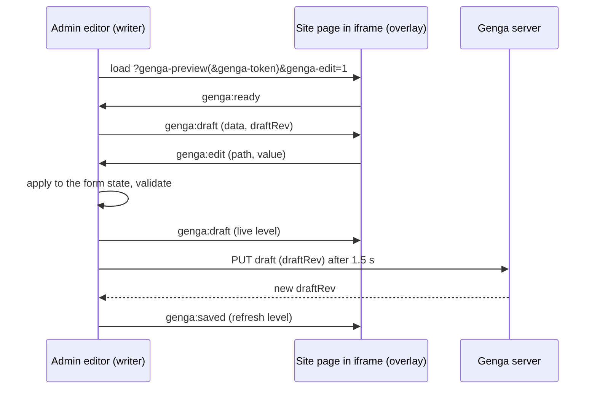

# On-site editing (design)

Status: design for a future feature. No code exists. Related: [Framework adapters](./adapters.md),
[Preview bridge](./preview-bridge.md), [GNG-1](https://linear.app/sakuga-software/issue/GNG-1).

Today an editor changes content in a form, and the site page shows the result in an iframe. On-site editing lets the
editor change the content on the page itself:

- click a title or a paragraph and type in place,
- edit rich text in place, with a small toolbar,
- add, move, duplicate and delete blocks from a block toolbar,
- later, see who else edits the page, and edit together in real time.

Every change goes to the same draft as the form. Publish, versions and access rules do not change.

## 1. Decisions

| #   | Decision                                                                                                                                                                          |
| --- | --------------------------------------------------------------------------------------------------------------------------------------------------------------------------------- |
| E1  | On-site editing runs **inside the admin editor**, as a mode of the preview pane. The page stays in an iframe; the admin keeps the session, the draft and the saves.               |
| E2  | An **overlay script** (`genga/edit`) runs in the page in preview mode only. It never calls the admin API. It sends edit intents to the admin by `postMessage`; the admin decides. |
| E3  | Renderers emit **field annotations** (`data-genga-field`) with stable paths, in preview only. Custom components use small helpers of each adapter.                                |
| E4  | The overlay edits in a **floating editor** placed over the annotated element. It never mutates DOM that the framework owns.                                                       |
| E5  | Phase 1 keeps the **`draftRev` compare-and-set** and the 409 flow of today. One editor per document.                                                                              |
| E6  | Phase 2 adds **presence** over **SSE plus POST**, fanned out in process. `LISTEN/NOTIFY` waits for multi-replica support.                                                         |
| E7  | Phase 3 (a direction, not a commitment) uses a **CRDT (Yjs)**, with the JSON draft kept as a materialized snapshot. Operational transform is rejected.                            |
| E8  | No editing code and no annotation reach a public response.                                                                                                                        |

## 2. Architecture options

### Where the editing UI runs

| Option                                                          | For                                                                                                                           | Against                                                                                                                                       |
| --------------------------------------------------------------- | ----------------------------------------------------------------------------------------------------------------------------- | --------------------------------------------------------------------------------------------------------------------------------------------- |
| **A. Overlay in the framed page, admin as the writer** (chosen) | Reuses the session, CSRF check, autosave and conflict UI of the admin. Works in both modes. Credentials never enter the site. | Needs annotations in the renderers. Two windows to keep in sync.                                                                              |
| B. Overlay in a top-level site page that calls the admin API    | No iframe; the page looks like the public page.                                                                               | Remote mode needs cross-origin writes with credentials (CORS with cookies, third-party cookie rules). The site origin would hold write power. |
| C. The admin re-renders the page itself                         | Full control of the DOM.                                                                                                      | Impossible for Vue, Svelte and Astro components, and wrong for React: the page is the site code, not the admin.                               |
| D. A browser extension                                          | No change to the site.                                                                                                        | Install friction, store review, one build per browser.                                                                                        |

Option A keeps the admin as the only writer: the frame sends intents, and the admin validates them, applies them and
saves them with its session. A full width "on-site" layout of the preview pane hides the form, so the editor sees
only the page. The form stays one click away: it is the accessible fallback and the place for fields that have no
visible element (SEO description, slug, tags).

Option B can come later for embedded mode only, where the page and the admin share an origin. It is out of scope
here.

### How the overlay reaches the page

The adapter loads `genga/edit` only when the server has accepted the preview (session on the same origin, token on
another origin, see [adapters](./adapters.md#34-preview)) **and** the URL holds `genga-edit=1`. The editor adds this
parameter in on-site mode. The script is part of the site bundle (a dynamic `import()` in the preview component of
each adapter), so the site CSP needs no new script origin, and the public bundle does not load it.



## 3. Field annotations

### Paths

A path names one value in the document data. Segments are field names, and the `_id` of an array item or a block. An
index is never used, because a move changes it.

```
title
body/8d2f…/title
body/8d2f…/items/c71a…/label
seo/description
```

Grammar: `segment ("/" segment)*`, where a segment is a field name or an item `_id`. Field names in the config
contain no `/` (a check of `defineConfig` adds this rule). A `group` adds a segment (`seo/description`); `tags` and
`richText` are leaves. The admin resolves a path against the schema. A path that does not resolve, or that resolves
to a field that the user cannot change, is ignored.

Values in `genga:edit` use the **stored shape**, not the public shape of `genga:draft`: a media id (not a media
object), TipTap JSON (without `html`), a plain string. The admin populates the draft and sends the public shape
back.

### Attributes

| Attribute               | On                                         | Value                                                       |
| ----------------------- | ------------------------------------------ | ----------------------------------------------------------- |
| `data-genga-field`      | the element that shows a value             | its path                                                    |
| `data-genga-field-type` | same element                               | `text`, `textarea`, `richText`, `media`, `number`, `select` |
| `data-genga-block-id`   | block wrapper                              | as today                                                    |
| `data-genga-list`       | the wrapper of a `blocks` or `array` field | its path; the target of insert and move                     |

The renderers emit these attributes only when `preview` is true. A public response has none.

### Helpers per framework

`<Blocks>` annotates block wrappers by itself. Fields inside a block need the block author:

| Framework | Helper                                                                |
| --------- | --------------------------------------------------------------------- |
| React     | `const field = useGengaField(); <h2 {...field('title')}>{title}</h2>` |
| Vue       | `<h2 v-genga-field="'title'">{{ title }}</h2>`                        |
| Svelte    | `<h2 use:gengaField={'title'}>{title}</h2>`                           |
| Astro     | `<h2 {...gengaField(Astro.props, 'title')}>{title}</h2>`              |
| HTML      | `data-genga-field="body/8d2f…/title"` by hand                         |

The helper knows the block context (`_id`, list path), so the author writes only the field name. Outside preview,
the helper returns no attribute. A field without an annotation stays editable in the form; the overlay simply does
not offer it.

## 4. The overlay

### Editing a value

1. The overlay finds annotated elements and draws an outline on hover and on focus.
2. A click, or `Enter` on the focused outline, opens a **floating editor**: an element in a shadow root, placed over
   the target, with the same box and the computed font, size, line height and color of the target.
3. The target gets `visibility: hidden` while the editor is open. Nothing else in the framework DOM changes.
4. Opening sends `genga:edit:start { path }`. Each change sends `genga:edit { path, value }` to the admin, at most
   once per animation frame. The admin applies it, validates it, and sends `genga:draft` back as today.
5. `Escape` restores the value from before the editor opened. `Enter` (plain text) or a click outside closes the
   editor and keeps the value.

Why a floating editor and not `contenteditable` on the target: React, Vue and Svelte own their DOM. A direct edit
fights the next render, and an Astro refresh replaces the HTML. The floating editor leaves the framework DOM alone,
and the next render shows the value that the admin confirmed.

### Rich text (phase 1b)

The floating editor of a `richText` field is a TipTap editor. `genga/edit` exports the extension list of the admin,
so both produce the same schema and the sanitizer accepts the output. It sends the TipTap JSON. TipTap normally
injects a `<style>` element into `document.head`, which a strict site CSP blocks: the overlay sets
`injectCSS: false` and puts the TipTap styles in its own stylesheet file, adopted in the shadow root. The overlay
loads TipTap lazily, on the first rich text edit, so plain text editing stays small.

### Blocks

A block toolbar appears on the focused block: move up, move down, duplicate, delete, and "insert after". The overlay
sends intents, never data:

| Message                 | Payload                                           |
| ----------------------- | ------------------------------------------------- |
| `genga:block:insert`    | `listPath`, `afterId` (or null), `type`           |
| `genga:block:move`      | `listPath`, `id`, `afterId`                       |
| `genga:block:duplicate` | `listPath`, `id`                                  |
| `genga:block:delete`    | `listPath`, `id`                                  |
| `genga:block:open`      | `id`: opens the form of the block in a side panel |

The admin applies the intent with the same code as the form (allowed types, `maxItems`, new `_id`), then sends the
new draft. Insert opens the block picker of the admin, so the overlay needs no copy of the schema. A block field
without a visible element (an image `alt`, a link URL) is edited in the side panel.

### Media

A click on an annotated image opens the media picker of the admin, as a dialog over the iframe. The overlay sends
`genga:media:pick { path }`; the admin writes the chosen media id.

## 5. Phases

### Phase 1: inline editing, one user

Scope: sections 3 and 4, for one editor at a time, in two steps. **1a**: plain text fields, block intents and media.
**1b**: rich text in place.

- **Saves.** The admin keeps its autosave: 1.5 s after the last change, `PUT draft` with `draftRev`. A 409 shows the
  existing conflict dialog (reload or keep mine).
- **Soft lock.** When a document is open in the editor, the admin writes a heartbeat
  (`genga_document_editors(document_id, user_id, seen_at)`, every 20 s). A second editor sees "Marie edits this
  page" and can still continue. This is advice, not a lock: the `draftRev` check stays the safety net.
- **Undo.** `Ctrl+Z` in the floating editor undoes inside the field. The admin keeps its own history for block
  intents.

Acceptance:

- In the four adapter examples, an editor changes a title, a paragraph of rich text, and the order of two blocks on
  the page, then publishes.
- With the overlay open, a public request of the same URL (no session, no token) has no `data-genga-*` attribute and
  loads no `genga/edit` chunk.
- The keyboard path works end to end (section 7).
- A conflict between two tabs shows the 409 dialog and loses no data.

### Phase 2: presence

Scope: who is on the document, and which field each person edits. No merging of content.

- **Transport.** Server-Sent Events plus POST:
  - `GET <adminPath>/api/documents/:id/events` (SSE) streams presence and save notices.
  - `POST <adminPath>/api/documents/:id/presence` sends the local state (focused path, selection) at most twice per
    second.
  - Both need the session and the `read` permission on the document. The POST passes the Origin check.
- **Why SSE and not WebSocket.** Adapters mount Genga as a Fetch handler (`(Request) => Response`). Next.js, Astro
  and SvelteKit route handlers cannot upgrade a connection to a WebSocket, but they can return a streamed
  `Response`. Each tab holds one SSE connection, so the HTTP/1.1 limit of six connections per origin is not a
  problem.
- **Stream hygiene.** The handler sends `Cache-Control: no-store, no-transform` (Next and other servers compress,
  which buffers the stream), `X-Accel-Buffering: no`, and a comment line every 15 s. It ends the stream on
  `request.signal` abort, so every adapter must wire the close of the connection to that signal (`toNodeListener`,
  the Nuxt handler).
- **Fan-out.** Genga is one process (adapters, decision D10), so an in-process map of subscribers carries presence
  and save notices. MCP writes run in the same process and use the same map. Postgres `LISTEN/NOTIFY` is not needed
  for one process. It becomes the fan-out only if Genga supports more than one replica, and then needs a dedicated
  connection outside the pool (`LISTEN` fails behind PgBouncer in transaction mode). Presence stays in memory with a
  30 s expiry.
- **In the page.** The admin holds the SSE connection, and relays presence to the frame with
  `genga:presence { users: [{ id, name, color, path }] }`. The overlay draws a colored outline and a name label on
  the fields that other people edit. The frame still holds no credential.
- **Save notices.** When another person saves, the admin gets `draft.saved { draftRev, by }`. If the local draft has
  no unsaved change, it reloads the draft. If it has some, it shows "Marie saved a newer version" before the 409 can
  happen.

Acceptance: two browsers on the same document see each other within 2 s, see the field that the other edits, and get
a notice on each save of the other.

### Phase 3: real-time collaboration (direction)

Scope: two or more people type in the same document at the same time, and the changes merge without a conflict
dialog. This phase is a separate project with its own design review. This section records the direction and the
problems that review must solve.

**Data model: Yjs.**

| Data                                           | Yjs type                                                           |
| ---------------------------------------------- | ------------------------------------------------------------------ |
| The document                                   | one `Y.Doc` per document draft                                     |
| Plain fields                                   | `Y.Map` of field name to value (`text` and `textarea` as `Y.Text`) |
| `richText`                                     | `Y.XmlFragment`, bound to TipTap with the Collaboration extension  |
| `blocks`, `array`                              | `Y.Array` of `Y.Map`, each with its `_id`                          |
| `group`                                        | nested `Y.Map`                                                     |
| `media`, `select`, `number`, `boolean`, `date` | a value in the `Y.Map` (last writer wins)                          |

**Why a CRDT and not operational transform.**

| Option                              | For                                                                       | Against                                                                                       |
| ----------------------------------- | ------------------------------------------------------------------------- | --------------------------------------------------------------------------------------------- |
| **Yjs (CRDT)** (chosen)             | Mature, TipTap support, merges in any order, works offline for short gaps | Binary updates to validate, memory per open document, a new dependency                        |
| Operational transform (ShareDB)     | Small documents, server authority                                         | One transform per data type, JSON plus ProseMirror needs two systems, a less active ecosystem |
| `prosemirror-collab` + field locks  | Simple, central authority                                                 | Rich text only; blocks and plain fields still need locks                                      |
| `draftRev` + field-level locks only | No new dependency                                                         | Two people cannot type in the same rich text field; this is phase 1 and 2, not collaboration  |

**Server.**

- The server keeps one `Y.Doc` in memory per open document, created from the JSON draft on the first connection.
- Updates arrive by POST (`<adminPath>/api/documents/:id/sync`) and leave by the SSE stream of phase 2. This is the
  Yjs sync protocol on SSE plus POST, with a small custom provider. A WebSocket provider (`y-websocket`, Hocuspocus)
  can be an option of the server image later, where a WebSocket upgrade is possible.
- Each update is appended to `genga_draft_updates(document_id, seq, update, user_id, at)`. A compaction job merges
  them into a snapshot when the document has no editor for 5 minutes.
- **The JSON draft stays the source for everything else.** At most once per second, the server writes the
  materialized JSON to `genga_documents.draft` and increments `draftRev`. Preview, publish, versions, MCP and the
  public API read JSON as today. Publish first flushes the pending updates.
- **MCP writes during a session.** An MCP `save_draft` on a document with an open `Y.Doc` goes into the `Y.Doc` as a
  transaction, not around it.

Problems for the phase 3 review:

1. The form still saves with `PUT draft` and `draftRev`. With an open `Y.Doc`, the form must write through the
   `Y.Doc` too, or the two writers conflict.
2. Checking that a binary update stays in the schema needs to apply it to a scratch copy of the `Y.Doc` first.
   Measure the cost.
3. The round trip from `Y.XmlFragment` to TipTap JSON must give the same output as the sanitizer, for every node and
   mark of the allowlist.
4. The way MCP tools write into an open `Y.Doc` needs its own contract.

**Validation.** A merge can produce a value that a single writer could not: two inserts can pass `maxItems`, for
example. The server checks the materialized JSON with the draft rules (tolerant) and the sanitizer before each
snapshot. It does not reject updates: it marks problems in the editor, as the form does today, and publish keeps its
strict validation. The server rejects an update that is larger than 1 MB, or that changes a field outside the schema
once applied to a scratch copy (problem 2).

**In the page.** The admin holds the `Y.Doc` provider. The frame keeps `genga:draft` as its input, and gets remote
cursors in rich text by `genga:presence`. The floating rich text editor in the frame binds to a sub-document that
the admin relays by `postMessage` (`genga:y:update`, binary). This keeps credentials in the admin.

Acceptance: two people type in the same rich text field and in two different blocks at the same time for one minute;
both end with the same content; publish gives that content; the version history shows one version per publish, not
per keystroke.

## 6. Security

- **Who can edit.** Only a signed-in user with `update` on the document. A preview token gives read access to one
  draft, never write access. All writes go through the admin API, with the session, the Origin check and the access
  rules of today (an `author` changes only its own documents).
- **Trust in the page (confused deputy).** Any script that runs in the previewed page can post `genga:edit`
  messages, and the `event.origin` check passes because it is the site origin. Tags, analytics, a compromised
  dependency or an XSS in site code could therefore change a draft through the editor's session. Mitigations:
  - the admin accepts edit messages only while on-site mode is on, and only for the path that the overlay opened
    with `genga:edit:start` after a user click or key press;
  - the admin limits edit messages (for example 30 per second) and never publishes from a frame message: publish
    stays a button of the admin;
  - the audit entry of each save marks `via: "on-site"`, and the version history shows the change before any
    publish;
  - adapters turn analytics and third-party tags off on preview responses. The remaining assumption is stated: in
    on-site mode, the site code is trusted to the same level as the draft it edits.
- **No editing code on public responses.** The adapter loads `genga/edit` only after an accepted preview (session or
  token) and `genga-edit=1`. Preview responses are `private, no-store`. An e2e test checks a public response for
  `data-genga-` attributes and for the edit chunk.
- **Messages.** As in the preview bridge: exact target origins, checks of `event.origin` and `event.source`, and the
  document id. The admin treats every `genga:edit` value as untrusted input: it validates it with the field schema,
  and sanitizes rich text, before it enters the draft.
- **CSP.** The overlay is first-party code of the site bundle. Its styles, TipTap styles included
  (`injectCSS: false`), are a stylesheet file served with the chunk and adopted in a shadow root. The prototype must
  confirm that no site CSP needs `'unsafe-inline'` for it. The admin keeps `frame-src` limited to the preview
  origins.
- **Clickjacking.** The site allows framing only by the admin origin on preview responses (`frame-ancestors`), as
  the preview bridge already requires.
- **Phase 2 and 3.** SSE and sync endpoints need the session; the server checks `read` at connection and `update` on
  each POST. A disabled user loses its streams at once.

## 7. Accessibility

On-site editing must meet WCAG 2.2 AA, like the admin.

- **Keyboard.** An "Edit on page" mode adds one focusable outline per annotated field, in document order. `Tab`
  moves between them, `Enter` opens the floating editor, `Escape` closes it and returns focus to the outline. Page
  links do not navigate in this mode.
- **No drag only.** Block moves have buttons and shortcuts (`Alt+ArrowUp`, `Alt+ArrowDown`). Drag can come later as
  an extra (WCAG 2.5.7).
- **Names and roles.** The floating editor is a `textbox` (or the TipTap editor with `aria-multiline`) named by the
  field label from the schema, for example "Title, block Hero". The block toolbar is a `toolbar` with arrow-key
  navigation.
- **Announcements.** A live region in the admin announces saves, conflicts and, in phase 2, "Marie edits the title".
  Announcements are polite and grouped, so typing by another person does not flood a screen reader.
- **Focus and contrast.** Outlines have 3:1 contrast against the page and do not rely on color alone (a label shows
  the field name). The overlay respects `prefers-reduced-motion`.
- **Equivalent path.** Every action of the overlay exists in the form, which stays one click away.

## 8. Messages

This is the one table of the bridge messages. All of them join the `PreviewMessage` type of the core, so every
adapter shares one definition, and all follow the origin rules of the
[preview bridge](./preview-bridge.md#messages).

| Message                                            | From   | Status           | Purpose                                             |
| -------------------------------------------------- | ------ | ---------------- | --------------------------------------------------- |
| `genga:ready`, `genga:hello`                       | both   | exists           | Handshake                                           |
| `genga:draft`                                      | editor | exists           | The populated draft; the confirmed value of an edit |
| `genga:select`, `genga:focus`                      | both   | exists           | Selection of a block on the page and in the form    |
| `genga:saved`                                      | editor | adapters, step 1 | Refresh of server-rendered blocks                   |
| `genga:token`                                      | editor | adapters, step 1 | A fresh preview token (remote mode)                 |
| `genga:edit:start`, `genga:edit`, `genga:edit:end` | frame  | phase 1          | Open a field, change its value, close it            |
| `genga:block:*`                                    | frame  | phase 1          | Block intents (section 4)                           |
| `genga:media:pick`                                 | frame  | phase 1          | Open the media picker for a path                    |
| `genga:presence`                                   | editor | phase 2          | Who edits which path                                |
| `genga:y:update`                                   | both   | phase 3          | Yjs updates of a rich text field                    |

## 9. Out of scope

- Editing on a top-level page without the admin (option B).
- Comments, suggestions and tracked changes.
- Editing of fields that have no visible element, except through the side panel.
- Offline editing beyond the short gaps that Yjs merges.
- More than one replica. Presence would then need `LISTEN/NOTIFY` on a dedicated connection, and the in-memory
  `Y.Doc` of phase 3 one owner per document.

## 10. Open questions

1. Is the soft lock of phase 1 enough for the owner's teams, or is a hard lock per document wanted before phase 3?
2. Phase 3 adds Yjs and its TipTap binding to the admin bundle (size to measure in the prototype). Load it only when
   a second person joins?
3. Should MCP clients appear in presence (as "Claude, via MCP")?
