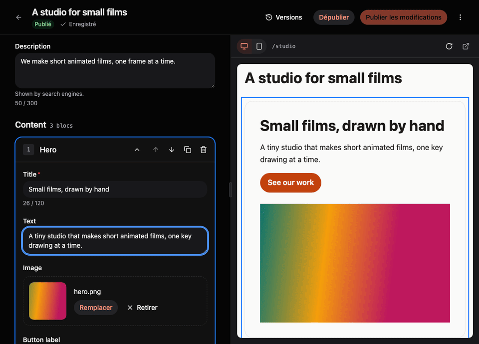

<p align="center">
  
</p>

<h1 align="center">Genga 原画</h1>

<p align="center">
  <strong>A React CMS that lives inside your app, and edits your real components live.</strong>
</p>

Genga gives your site an admin, roles, drafts, versions, a media library, and a live editor
that renders **your own React components** as you type. It stores content in Postgres.

Use it in two ways:

- **As a library** inside a React Router app: the site and the CMS share one server, one
  deploy and one Postgres database.
- **As a headless CMS** with the Docker image `ghcr.io/sakuga-software/genga`: a public JSON
  API and a live preview bridge for a site in any stack.

<p align="center">
  
</p>

> **Status:** 0.x, early. The admin UI is in French for now.

## Install

```sh
npm install genga react react-dom react-router
```

Requirements: Node 22.12 or later (React Router 8 needs 22.22), React 19, React Router 7.18 or
8.5 and later, Postgres 14 or later. `genga-migrate` applies the database migrations
(`DATABASE_URL` must be set).

## Entries

| Entry             | Content                                                                        |
| ----------------- | ------------------------------------------------------------------------------ |
| `genga`           | `defineConfig`, `defineBlock`, field builders, access rules, `richTextToHtml`  |
| `genga/server`    | `createGenga()`: auth, documents, published reads, media, admin loaders, API   |
| `genga/remote`    | `createRemoteSource()`: reads a Genga server with `fetch` only, edge-safe      |
| `genga/admin`     | the admin route components                                                     |
| `genga/admin.css` | the compiled admin stylesheet (your app needs no Tailwind setup)               |
| `genga/client`    | `RenderBlocks`, `RichText`, `usePreviewData`, the preview bridge, `apiRequest` |
| `genga/render`    | `RenderBlocks`, `RichText`, `usePreviewData`                                   |
| `genga/preview`   | `connectPreview` for any framework, no React                                   |

## A block

A block is one React component of your site plus its field schema. The editor renders that
component, on the real route, with the draft data.

```tsx
import { defineBlock, text, textarea } from 'genga';

export const heroBlock = defineBlock({
  type: 'hero',
  label: 'Hero',
  fields: {
    title: text({ label: 'Title', required: true, maxLength: 120 }),
    text: textarea({ label: 'Text', rows: 2 }),
  },
  component: ({ title, text: body }) => (
    <section className="hero">
      <h2>{title}</h2>
      {body && <p>{body}</p>}
    </section>
  ),
});
```

The [quick start](https://github.com/sakuga-software/genga#quick-start-inside-a-react-router-app)
shows the config, the instance, the admin routes and a page with live preview. The
[example app](https://github.com/sakuga-software/genga/tree/main/examples/react-router) has every
route module.

## New since 0.2.0

These changes are on `main` and in the [changelog](https://github.com/sakuga-software/genga/blob/main/CHANGELOG.md):

- **`genga.handle(request, context?)`**: one Fetch handler for the admin API, the media files,
  the public API and the MCP endpoint. It returns `null` for the other paths.
  `genga.api`, `genga.mcp` and `genga.media.serve` are deprecated.
  Read [configuration](https://github.com/sakuga-software/genga/blob/main/docs/configuration.md#one-handler-gengahandle).
- **Publish events and webhooks**: `genga.events.on()` in process, and signed webhooks in the
  Standard Webhooks format, with the cache tags to invalidate. `tagsFor()` gives the same tags
  to your reads, and `verifyWebhook()` checks a webhook on Node and edge runtimes. Read
  [events](https://github.com/sakuga-software/genga/blob/main/docs/events.md).
- **`genga/remote`**: `createRemoteSource()` reads the public API of a Genga server with the
  same `GengaSource` interface as `createGenga()`: `getDocument`, `listDocuments`,
  `resolveRoute`, `getDraft`, `sitemap` and `tagsFor`. Read
  [content source](https://github.com/sakuga-software/genga/blob/main/docs/content-source.md).

## Documentation

- [README with the full quick start](https://github.com/sakuga-software/genga#readme)
- [Architecture](https://github.com/sakuga-software/genga/blob/main/docs/architecture.md)
- [Configuration](https://github.com/sakuga-software/genga/blob/main/docs/configuration.md)
- [Blocks](https://github.com/sakuga-software/genga/blob/main/docs/blocks.md)
- [Preview bridge](https://github.com/sakuga-software/genga/blob/main/docs/preview-bridge.md)
- [Headless server](https://github.com/sakuga-software/genga/blob/main/docs/headless-server.md)
- [Public API](https://github.com/sakuga-software/genga/blob/main/docs/api.md)
- [MCP for AI agents](https://github.com/sakuga-software/genga/blob/main/docs/mcp.md)
- [Security model](https://github.com/sakuga-software/genga/blob/main/docs/security.md)

## License

[MIT](https://github.com/sakuga-software/genga/blob/main/LICENSE) © Sakuga Software
